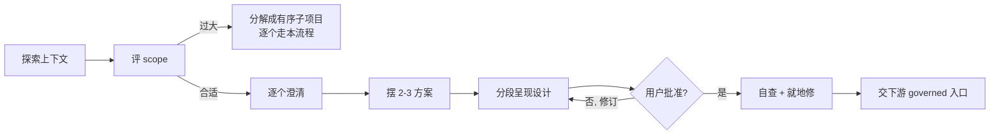

# Brainstorming：把想法理成设计

在动工前，用协作对话把一个模糊想法 / 需求 / story 理成成形设计。这是 plan 模式的默认「想清楚」环节，位于架构 review（`/arch-change`）的**上游**（dev-loop `/build-feature` 档 2 迁入后，也位于其上游），属 AGENTS.md 明列的「规划讨论」例外，不是实现工作。

<HARD-GATE>
拿出设计并得到用户批准前：不写代码、不改实现面（固件/shim）、不改 `docs/contracts/**`、不搭脚手架、不调用任何实现 / 落地入口。无论需求看起来多简单都适用。本 skill 的产物是**达成一致的设计**，不是实现。
</HARD-GATE>

## 反模式："这太简单不用设计"

每个项目都要走这一步——待办清单、单函数工具、配置改动都一样。越"简单"的项目，未经审视的假设越容易造成返工。设计可以短（简单项目几句话就够），但你必须把它拿出来、拿到用户批准。

## Checklist（按顺序，一步一 task）

1. **探索上下文** — 先看相关文件、docs、最近 commit。能从代码 / 文档查到的答案，去查，别拿去问用户。
2. **先评 scope** — 若需求含多个独立子系统（如"带聊天+文件+计费+分析的平台"），立即点出、先分解，别急着抠一个需要拆分的项目的细节。
3. **逐个澄清** — 一次一个问题，搞清 purpose / 约束 / 成功标准。优先多选题，也给出你的推荐答案。一条消息只问一个问题。
4. **摆 2–3 个方案** — 每个带 trade-off，先亮你推荐的那个并说明为什么。
5. **分段呈现设计** — 每段按复杂度伸缩（straightforward 几句、nuanced 200–300 字），**每段都问一句「到这儿对不对」**再往下。覆盖：架构、组件、数据流、错误处理、测试。
6. **达成一致** — 拿到用户对整体设计的批准；哪里说不通就退回去澄清。
7. **自查** — 扫占位符 / TODO、内部矛盾、scope 是否过大需拆、有无二义；就地修，不必再复审。
8. **交接下游** — 唯一允许的「下一步」是把成形设计交给 governed 入口（见下），不是自己动手实现。

## 流程

## 关键原则

- **一次一个问题** — 别一次抛一堆，会让人懵。
- **优先多选题** — 比开放式好答；但都附上你的推荐答案。
- **狠狠 YAGNI** — 把不必要的功能从每个设计里砍掉。
- **总是探索备选** — 定案前先摆 2–3 个方案。
- **增量验证** — 呈现一段、批准一段，再往下。
- **为隔离和清晰而设计** — 拆成职责单一、接口清楚、能独立理解和测试的小单元；每个单元都能答清「它做什么、怎么用、依赖什么」。文件变大常是"做太多"的信号。
- **在既有代码里工作** — 先摸清现有结构、顺着现有 pattern 改；只做服务于当前目标的针对性改进，别捎带无关重构。

## 交接下游（terminal state — 本 workspace 专属）

brainstorming 到「达成一致的设计」为止。**不自己实现、不写 canonical spec**（那些各有 owner）。按设计落到哪条 lane，把它作为输入交给对应 governed 入口：

- **要实现**（feature / bug fix / behavior / test）→ 档 1 期间由 human 决定是否临时跳过流程一次性执行（如实记录）；档 2 dev-loop 迁入后交 **`/build-feature`**。
- **架构 / 治理 / spec 意图或拓扑**（`docs/requirements.md` + `docs/architecture.md`、`docs/contracts/**`、`.claude/**`、指令根）→ 把成形设计**落 `delivery/changes/`（或 `delivery/workstreams/` scratch）作讨论稿**，交 **`/arch-change`**（review-moderator 分类；**成形设计已落 delivery/changes/ 作讨论稿的，按『已有 proposal』跳过 architect 起草**；输入仅瘦 plan、无落盘上下文时才反派 architect 起草候选，走对抗 review）。
- **纯契约改动**（`docs/contracts/**`：shim API / display 块 / 笔顺 JSON / 课表 MD）→ 交 **architect-reviewer** + 人类契约门。

成形设计即讨论稿，落 `delivery/changes/`（或 `delivery/workstreams/` scratch）作 `/arch-change` 的『已有 proposal』输入（非 canonical）；canonical 正式 spec 由下游 owner（architect）产出。

---

_方法借鉴 obra/superpowers 的 brainstorming skill；terminal state 与文档边界已适配本仓治理（dev-loop / arch-change / 契约门）。_
