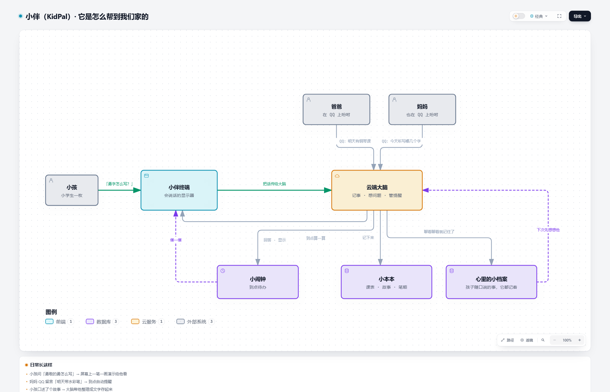
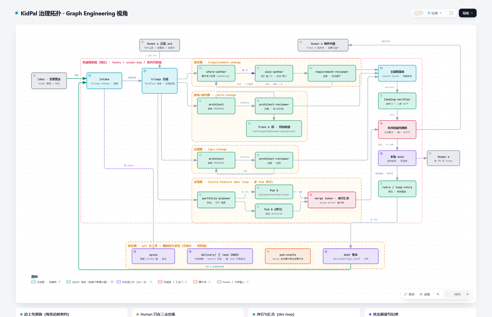

# KidPal 小伴 · 一个管理者用 AI Agent 团队造出来的产品

> 一个做了 15 年软件交付管理的人，把带工程师团队的方法论原样搬去带一支 AI Agent 团队。
> 这个仓库装着两层东西：**方法**——一套 AI 原生的多智能体研发治理框架（Graph Engineering）；**证据**——用它从 0 到 1 做出来的真实产品（KidPal，一个小学生的 AI 小伴终端）。

**English abstract**: This repository contains two things. (1) *Graph Engineering* — an AI-native governance framework that makes software governance an explicit graph: a full agile team mapped onto specialized LLM agents as nodes, four closed change loops (requirements / architecture+contracts / governance / implementation) as edges, each running draft → independent review → freeze → landing → independent verification → retrospective, with acceptance tests frozen before work begins, a single-source-of-truth interface contract, adversarial red-team/blue-team review for structural changes, machine-enforced permission boundaries, and risk-graded escalation to a human. (2) *KidPal* — a real product built entirely by that agent team under this governance: an ESP32-S3 companion terminal for an elementary-school kid, backed by a cloud "brain" that remembers what the kid shares across sessions and that parents talk to through QQ. Every change in this repo keeps its full audit trail (proposal, landing summary, independent verdict, retrospective) — see the evidence section below. Documentation is primarily in Chinese.

---

## 两张图看懂这个仓库

**产品这层**：小孩对终端说话，云端大脑负责思考和记忆，爸爸妈妈在 QQ 上吩咐大脑——不用装任何 App。

**方法这层**：每个变更从 idea 到合并进 main，要走完一条有门禁、有分工、有复盘的流水线——人在里面只做三个动作：立项、例外拍板、批 PR。

---

## 产品层：KidPal 是什么

一个父亲的真实痛点：记不住小孩平时到底有哪些课；他问的问题我不一定有时间答；写作业一会儿问这个字怎么写、一会儿问那个字怎么写；喜欢讲故事，自己写又半天写不出来。

于是有了小伴：

- **常显课表**——ESP32-S3 终端摆在桌上，首页就是「接下来有什么课」；
- **语音问答**——按键或喊一声就能问问题，云端大脑接 DeepSeek 回答；
- **笔顺演示**——问「勇字怎么写」，屏幕上一笔一画演示（覆盖 9574 个汉字）；
- **故事整理**——小孩口述故事，云端帮他整理成文字存起来；
- **越用越懂孩子（记忆）**——孩子聊天时随口说的事（喜欢什么颜色、小狗叫什么、同学是谁），小伴会默默记下；同一句话里追问、隔天新开一句再问，都答得上来；
- **到点提醒**——妈妈在 QQ 上说一句「明天带水彩笔」，设备到点自己开口提醒。

架构上设备是**哑终端**（只收音/放音/显示/按键，不懂业务），所有数据、逻辑、记忆在云端大脑（OpenClaw），家长通道就是 QQ——录入课表、留提醒，说一句就生效。记忆也在云端完成：大脑从对话里自动提炼「孩子世界的事实」形成记忆画像，每轮对话前注入——设备端不用为记忆做任何事，记忆跟着家庭走、不跟着某块板子走。

## 方法层：Graph Engineering 是什么

为什么叫 Graph：把研发治理显式建成一张图——角色是节点（一支敏捷团队整编制映射成 17 个专职 Agent，写代码的和验代码的绝不是同一个；human 在图上只有三个出场点：立项、例外拍板、批 PR——PR 也是 AI 起草的，但批准权只在人），流程是边，git 仓库里的档案是图的持久状态（所以天然可审计、可回滚）。

图上有**四条闭环（loop）**，对应软件研发的四个面，每条都走同一个七步：起草 → 独立审稿 → 冻结 → 落地 → 独立核验 → 复盘 → 合并：

- **需求面** `/requirement-change`——story-author 起草，requirement-reviewer 四查否回；
- **架构+契约面** `/arch-change`——architect 起草，architect-reviewer 四查；契约变更随批原子落地，合并过机械凭据闸；
- **治理面** `/gov-change`——框架自身的演进也走同一套 loop，没有例外；
- **实现面 dev loop** `/build-feature`——planner 派活 → 验收作者先把验收测试冻成「当前失败」（防止写假测试）→ builder 实现 → verifier 独立校验 ↔ fixer 修 → integrator 收拢 → supervisor 过合并门。

两个贯穿所有 loop 的转弯机制：**方向没收敛** → 升对抗段（Track A：红队蓝队辩论，中立判官裁定）；**评审连续三轮不绿** → 熔断，升级人拍板。反向也成立：小改动走轻量路径自动闭环，不背全套流程——守住底线，也保住速度。跨面的 idea 从 `/triage-change` 一个入口进，探测后按面分派，各面的门各归各裁。

这张图还会自己长：**每批变更收尾都趁热写复盘（retro），先于合并**；定期再跑 `/loop-retro` 周期复盘，把跨批的共性踩坑提炼成治理改进项，记进 `docs/debt/` 账本，再经 `/gov-change` 落回框架自身。你今天看到的这套流程不是一天设计成的，就是这样一圈一圈复盘长出来的。

支撑这一切落地的是**机器强制层**：scope-map 权限边界、hooks、校验脚本，把「AI 不能越权」变成机器可检查的规则（比如 agent 想直接推 main 会被钩子当场拦下，落地必须走人批准的 PR）；CodebaseMemory 知识图谱让 Agent 基于结构化的代码认知工作，而不是靠猜。

## 证据：这个仓库的历史就是展品

多智能体协作「能用」不稀奇，**可治理、可审计**才是这套框架要证明的事。本仓已有 40+ 个走完整治理流程的变更，每个变更留四份档案：立项提案（PROPOSAL）、落地摘要（landing summary）、独立核验结论（landing verdict）、复盘（retro）。

随便抽一个看：[delivery/review/261019-gov-review-docs-root-ledger-rehome/](delivery/review/261019-gov-review-docs-root-ledger-rehome/)——四份档案都在，核验官逐文件核对「实际落地 == 冻结提案」的记录也在。

想快进看全景：变更台账在 `delivery/review/INDEX.md` 与 `delivery/taskpackages/INDEX.md`，未结决策账本在 `docs/debt/`。

## 仓库地图

| 目录 | 是什么 | 给谁看 |
|---|---|---|
| `docs/requirements.md` / `docs/architecture.md` | 需求与架构的单一事实源 | 想了解产品设计的人 |
| `docs/contracts/` | 接口契约（笔顺 JSON / display 块 / 课表 MD / shim API） | 想改接口的人（先读变更纪律） |
| `docs/debt/` | 未结决策项账本，一条目一文件 | 想看「问题怎么被跟踪」的人 |
| `.claude/` | 治理机器：Agent 角色定义、hooks、校验脚本、权限边界 | 冲框架来的人，主战场在这 |
| `delivery/` | 全部变更的档案库（review / taskpackages / intake / retro） | 想验证「可审计」的人 |
| `docs/notes/` | 踩坑记录、协议分析、视觉解释稿、架构图 | 随便逛 |
| `firmware/` | 固件（基于小智 V2.1.0 的板级 overlay） | 嵌入式玩家 |
| `server/` | 云端 shim（接入网关、部署补丁、验收测试） | 想跑云端的人 |
| `ESP32-S3-RLCD-4.2-Demo/` | 第三方参考源码（本地只读参考，不随仓库发布） | — |

## 运行边界（先说清楚，免得白兴奋）

- 终端需要一块 **ESP32-S3-RLCD-4.2** 开发板；
- 云端需要一台 Linux 主机 + 若干外部服务 key（阿里云 ASR、DeepSeek、edge-tts、Tavily；记忆向量化另用阿里云 DashScope embedding，与 ASR 同账号；记忆画像库 Honcho 自托管，不占外部 key），QQ 通道依赖 OpenClaw 部署；
- 这是一个人的研究项目，文档全部为中文，持续演进中，接口和流程都可能变；
- 治理框架与产品代码同仓是刻意为之——框架的证据就在产品的历史里。

## 第三方与致谢

- 固件基座：[小智 xiaozhi-esp32](https://github.com/78/xiaozhi-esp32)（MIT），V2.1.0；
- 云端引擎：[xiaozhi-esp32-server](https://github.com/xinnan-tech/xiaozhi-esp32-server)（MIT，容器化部署 + 本地补丁）；
- 编排大脑：OpenClaw；记忆画像子系统：[Honcho](https://github.com/plastic-labs/honcho)（Plastic Labs，AGPL-3.0，自托管部署）；汉字笔顺数据：makemeahanzi（Arphic Public License）；
- 语音链路：阿里云 ASR（Qwen3-ASR-Flash）、edge-tts（微软非官方接口）；
- 治理图与业务图均由本仓内置的 archify 工具链（[tt-a1i/archify](https://github.com/tt-a1i/archify)）生成并过机检。

## License

本仓自有代码与文档以 MIT 发布（见 [LICENSE](LICENSE)，署名 David Fan）；第三方组件各归其许可，见上节。
