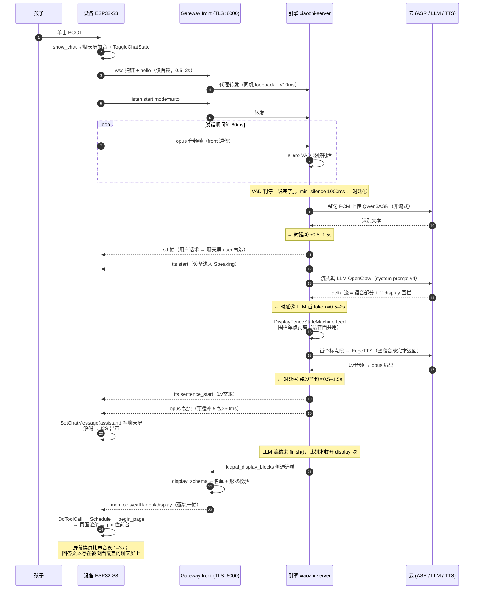
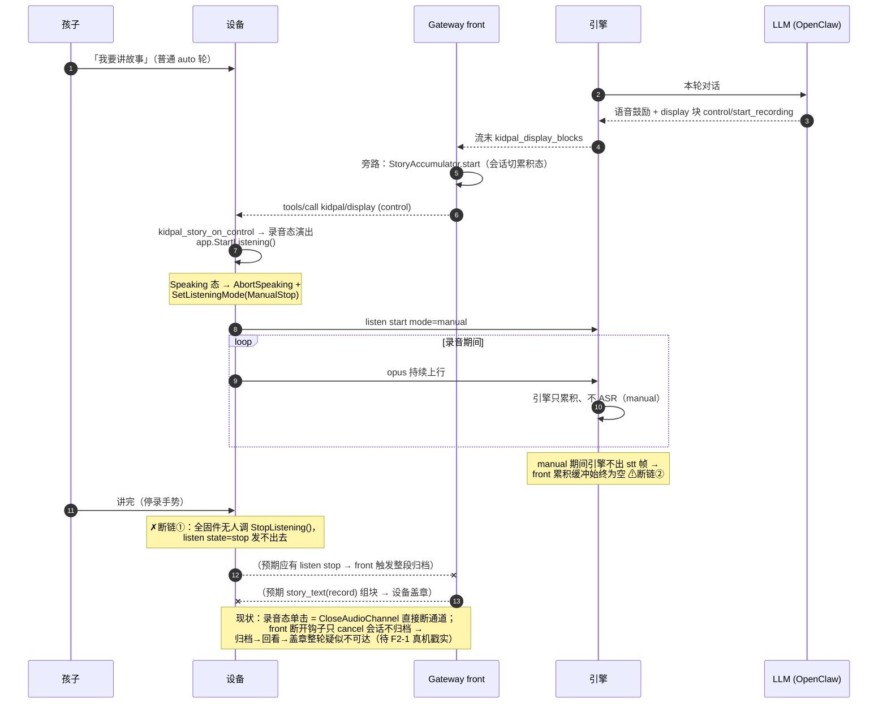
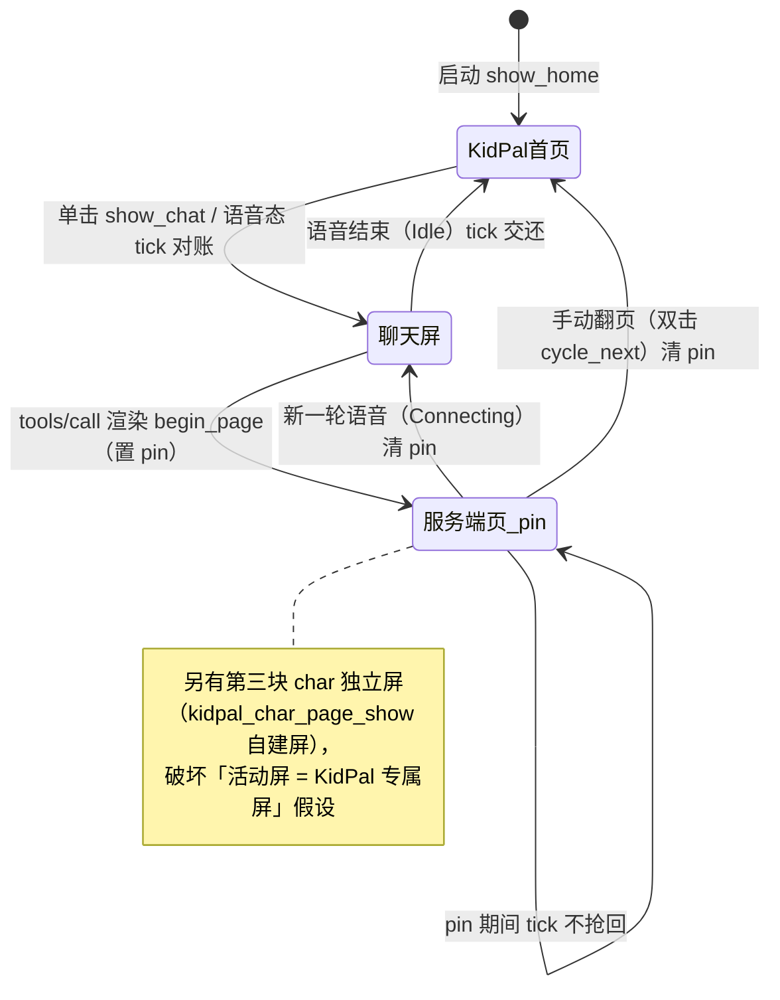

# 语音轮端到端流程梳理（2026-09-10）

> 包 `260829-hardware-validation` 收尾阶段，应 human 要求对「孩子问一句话 → 设备 →
> Gateway → 云 → 返回 → 解析 → 下一步去向 → 页面展示」整条链路做一次全面梳理，
> 附 UI 融合冲突点清单与时延归因。本文是**事实梳理**（按当前分支代码逐文件核对），
> 不是 PROPOSAL；review 通过后有价值结论再同步 spec。代码引用为
> `dev/260829-hardware-validation` 分支快照，行号会漂移、文件路径为准。

## 一、全链路总览

```
┌─ ESP32-S3 设备 (waveshare-s3-rlcd-4.2) ──────────────────────────────────────┐
│ 按键(单击) ──> Application::ToggleChatState / StartListening                 │
│ mic 16k PCM ──> opus 编码 ──> WebsocketProtocol.SendAudio (60ms/包)          │
│ 下行: opus 音频帧 + JSON 文本帧 (tts/stt/llm/mcp/system/alert)               │
│ 双屏: s_chat_scr (小智 SetupUI) ⇄ s_kidpal_scr (KidPal 四页) + char 独立屏   │
└────────────┬────────────────────────────────────────────────────────────────┘
             │ wss://8.137.91.16:8000 (自签 CA pinning, Bearer token)
┌────────────▼────────────────────────────────────────────────────────────────┐
│ Gateway front (server/gateway/front/front_app.py, uvicorn TLS :8000)         │
│  · HTTP upgrade 层强制 Bearer 鉴权 (403)                                     │
│  · 纯代理两条腿: pump_client_to_upstream / pump_upstream_to_client           │
│  · 文本面接管: 引擎侧通道帧 kidpal_display_blocks 拦截 → display_schema 校验  │
│    → kidpal/display tools/call 信封 → {"type":"mcp"} 帧发设备                │
│  · 旁路: stt 喂故事累积 / listen-stop 触发归档 / 回执消费 / 提醒轮询          │
└────────────┬────────────────────────────────────────────────────────────────┘
             │ plain ws://127.0.0.1:8010/xiaozhi/v1/ (同机 loopback)
┌────────────▼────────────────────────────────────────────────────────────────┐
│ 引擎 xiaozhi-esp32-server (docker, 补丁版 connection.py)                      │
│  VAD(silero) → ASR → 意图(nointent=直通) → LLM 流式 → TTS → opus 下发         │
│  补丁: DisplayFenceStateMachine 剥 ```display 围栏；闭合即收块、流末发侧通道   │
└──┬──────────────────┬───────────────────────┬───────────────────────────────┘
   │                  │                       │
   ▼                  ▼                       ▼
 ASR: Qwen3ASR-Flash  LLM: OpenClaw           TTS: EdgeTTS
 (dashscope 云, 非流式  (DeepSeek, loopback       (微软云, 逐段合成——
  整句文件上传)          127.0.0.1:18789 /v1)      段内收满才转发)
```

## 二、上行：孩子按一下之后发生什么

1. **按键**（[waveshare-s3-rlcd-4.2.cc:202](firmware/main/boards/waveshare-s3-rlcd-4.2/waveshare-s3-rlcd-4.2.cc#L202)）
   单击 = `Schedule(kidpal_render_node_show_chat)`（先把小智聊天屏切前台）+
   `ToggleChatState`（冻结语义不变）。
2. **建链**（application.cc `HandleToggleChatEvent`）：Idle 态且通道未开 →
   `kDeviceStateConnecting` → `WebsocketProtocol::OpenAudioChannel`（TLS 握手 +
   hello 握手）。**通道在轮间保持打开**：auto 模式一轮答完回 `Listening`
   （继续开麦听下一句），不关通道；真正关通道只有三条路——引擎静默超时、
   孩子在 Listening 态再按一下、断网。所以同一批真机轮的第 2 句起不再付握手成本。
3. **音频上行**：`MAIN_EVENT_SEND_AUDIO` → `protocol_->SendAudio`（60ms opus 包）。
4. **引擎收音频**（connection.py `_route_message` → `_decode_opus_packet` →
   `asr_audio_queue` → `receiveAudioHandle.handleAudioMessage`）：VAD 逐帧判活。
   **KidPal 日常语音轮是 auto 拾音模式**（2026-09-10 更正：单击 → ToggleChatState →
   aec_mode_=kAecOff（sdkconfig 两 AEC CONFIG 均未设）→ `kListeningModeAutoStop`
   → wire `{"type":"listen","state":"start","mode":"auto"}`）——**「说完没有」由引擎侧
   silero VAD 尾点判定**（asr/base.py auto 分支，`client_voice_stop` 置位才把整段缓存
   送 ASR），尾点等待约 0.5–1s。
   manual 模式只出现在**故事录音**一条路径：`control/start_recording` →
   `app.StartListening()`（HandleStartListeningEvent 于 Speaking 态 → AbortSpeaking +
   ManualStop）→ 引擎累积音频、不触发 ASR，直到收到 listen state=stop（见 5 的断链注记）。
5. **故事累积旁路**：若该会话处于累积态（之前 LLM 下发过 `control/start_recording`），
   引擎回带的 `stt` 帧会被 front `_story_feed_from_stt` 旁路喂进 StoryAccumulator，
   不进对话；listen-stop 触发整段归档（`_story_stop_on_listen_stop` →
   `archive_story` 落盘 → story_text(record) 组块下发设备盖章）。
   ⚠ **疑似断链（本梳理核查中发现，待真机 F2-1 验证戳实）**：全固件无任何代码调
   `Application::StopListening()` —— 设备**没有路径发出 `{"type":"listen","state":"stop"}`**，
   而云侧停录归档只认这一帧；录音态单击回 GLOBAL → ToggleChatEvent → Listening 态 →
   `CloseAudioChannel`（直接断通道，不发 stop，front 断开钩子只 cancel 不归档）。
   若坐实，故事录制→归档→盖章整轮在真机上不可达。
   ⚠ **疑似断链②（即使修好①仍不闭环）**：manual 录音期间引擎只攒音频、不出 stt 帧，
   front 的累积缓冲（靠 `_story_feed_from_stt` 喂）**始终为空**——停录归档拿到的是空
   转写（`archived=false reason=empty_accum`）；而整段音频在 listen stop 后由引擎
   `handle_voice_stop` 整体 ASR，转写会经 `startToChat` 当**普通聊天**进 LLM，不走归档。
   修法需要二选一收敛：设备补 StopListening 接线 + 引擎侧把整段 ASR 结果交给网关
   归档（不经对话面），或放弃 front 累积设计改由引擎/网关另立归档通道。

## 三、云侧：一句话的识别、思考、发声（引擎内部流水线）

`startToChat`（receiveAudioHandle.py:43）之后：

1. **stt 回显**：`send_stt_message` → `{"type":"stt","text":…}` 下发设备
   （设备把它写进聊天屏的 user 气泡）+ `{"type":"tts","state":"start"}`。
2. **意图**：live 配 `Intent=nointent` → `handle_user_intent` 前先做两步**本地**
   便宜匹配（退出命令精确匹配 check_direct_exit、唤醒词匹配），随后
   nointent provider 的 `detect_intent` 恒回 `continue_chat`（零模型调用）→ 直通进
   LLM（也没有 function_call 工具面——KidPal 的设备 MCP 工具
   `self.get_device_status` 等已注册但 nointent 模式下 LLM 不走工具调用路径）。
3. **LLM**（connection.py `chat`，补丁版）：OpenAI 兼容流式调 OpenClaw
   （`http://127.0.0.1:18789/v1`，model `openclaw/default`，**禁 max_tokens**）。
   System prompt = openclaw-system-prompt.v4.md（语音 ≤3 句 + 末尾必带 ```display
   块，7 view 白名单）。
4. **围栏剥离（引擎补丁，单点剥离机）**：每个流式 delta 过
   `DisplayFenceStateMachine.feed()`——围栏内文本**既不进 TTS 也不进转发文本**；
   围栏一闭合块就进 `blocks` 列表，但**要等整个流结束（finish()）才一次性发**
   `{"type":"kidpal_display_blocks","blocks":[…]}` 侧通道帧给 front。
   剥离前原文（含围栏）进对话历史（`_kidpal_original_reply`）。
   TTS 只吃语音部分；`llm` 情绪帧由首个非空 chunk 触发。
5. **TTS 管线**（tts/base.py，NON_STREAM 逐段合成）：
   语音 delta 进 `tts_text_queue` → `_get_segment_text` 按标点切段
   （**首句放宽到逗号**，后续只认句号/问号/叹号）→ 每段 EdgeTTS 合成 →
   opus 编码（24k 采样率对齐 hello）→ `tts_audio_queue` →
   `sendAudioMessage` 流控下发（预缓冲 5 包×60ms，之后实时速率）。
   段边界发 `{"type":"tts","state":"sentence_start","text":<段文本>}`；
   全部段完发 `{"type":"tts","state":"stop"}`。

## 四、下行：设备收到返回后怎么处理（对应 human 四问）

所有下行 JSON 帧在 [application.cc:448-534](firmware/main/application.cc#L448) 的
`OnIncomingJson` 分发（跑在 esp-ml307 `ssl_receive` 任务上，4KB 栈纪律见 mcp_server.cc 头注）：

| 帧类型 | 解析成什么 | 送到哪里 | 页面效果 |
|---|---|---|---|
| `tts start` | 状态机转换 | `SetDeviceState(Speaking)` | tick 把聊天屏切前台；状态栏「说话中」 |
| `tts sentence_start` | 段文本 string | `Schedule → display->SetChatMessage("assistant", …)` | **小智聊天屏**的对话区逐段刷新 |
| `tts stop` | 状态机转换 | auto 模式 → `Listening`（继续听）；manual（故事录音）→ `Idle` | auto：tick 保持聊天屏在前台（语音未结束）；Idle 才交还首页 |
| `stt` | 用户话术 string | `SetChatMessage("user", …)` | 聊天屏 user 气泡 |
| `llm` | emotion string | `SetEmotion(…)` | 聊天屏表情图标 |
| `mcp` | JSON-RPC payload | `McpServer::ParseMessage → DoToolCall` | 见下 |
| `alert`/`system` | 三元组/命令 | Alert 弹窗 / Reboot | — |

**音频帧（二进制）**：`OnIncomingAudio` → Speaking 态才入解码队列 → opus 解码 →
采样率对齐（引擎 hello `sample_rate=24000`、本板 `AUDIO_OUTPUT_SAMPLE_RATE=24000`
一致，直通无重采样；失配时 OnAudioChannelOpened 有告警）→ I2S → ES8311 出声
（真机已证可用）。

### mcp 帧的两条子路径

**A. display 路径（本链路的重点）**：front 把引擎侧通道块逐个校验
（display_schema 白名单 + 形状）后包成 `kidpal/display` 的 JSON-RPC `tools/call` 信封，
以独立 `{"type":"mcp"}` 帧逐块下发。设备侧 [mcp_server.cc:472](firmware/main/mcp_server.cc#L472)
的 `kidpal/display` 工具回调（**同步跑在 ssl_receive 任务**）按 view 路由：

- `text` → `SetChatMessage("assistant")`（聊天屏显示全文）；
- `schedule` → `kidpal_schedule_parse` → 堆分配 → `Schedule` 闭包 →
  `begin_page` → `kidpal_schedule_page_render` → `cache_schedule` → `end_page`；
- `story_list` / `story_text` → 同族解析（全部堆分配）→ `ScheduleStoryRender` 同法渲染
  （story_text 且 `archive_pend>0` 时先走盖章分支）；
- `char` → `kidpal_char_data_validate` 六键防御 → `kidpal_char_page_show`
  （自建**第三块屏**，不 clean 活动屏）；
- `control` → `end_session`/`stop_speaking` → AbortSpeaking；
  `start_recording` → 页态切录音 + `app.StartListening()`（上行重新开麦）；
- 白名单外 → 显式降级（friendly 文案，绝不盲渲染）。

`begin_page/end_page` 夹钳（[kidpal_render_node.cc:332](firmware/main/display/kidpal_render_node.cc#L332)）：
持 LVGL 锁 + 把活动屏预载为 s_kidpal_scr + 置 `s_page_pinned`，令页面渲染函数内部的
`lv_screen_active()+lv_obj_clean()` 清的是 KidPal 专属屏（SetStatus 悬空崩溃的根治点）；
pin 期间 1s tick 不把前台抢回聊天屏，直到新一轮语音（Connecting）或手动翻页清 pin。

**B. 通用 MCP 往返**：连接期引擎 `tools/list` 枚举设备工具；`DoToolCall` 在
main 任务执行工具回调并 `ReplyResult` 回 JSON-RPC result（经 `Application::SendMcpMessage`
上行）。提醒的「渲染即回执」（`kidpal/alert` → EmitRenderReceipt `"ack":true`）走这条路。

## 五、UI 融合「混乱」的架构根源（问题清单）

设备屏幕上并存**三块 LVGL 屏 + 两套 UI 体系**，前台归属靠分散在四个文件里的
标志位 + 1s 轮询对账决定：

| 屏 | 归属 | 建立处 | 谁写它 |
|---|---|---|---|
| s_chat_scr | 小智 SetupUI（状态栏/表情/对话气泡） | LcdDisplay::SetupUI | tts/stt/llm 帧、Alert、状态机 |
| s_kidpal_scr | KidPal 四页（home/char/schedule/story） | render_node init | 页面渲染函数 + begin_page 夹钳 |
| char 独立屏 | 查生字页 | kidpal_char_page_show | 同上 |

前台仲裁 = `kidpal_render_node.cc` 的 tick（1s）：`s_page_pinned`（服务端页驻留）
> 语音态抢回聊天屏 > Idle 交还首页。散布的状态标志：`s_page_pinned` /
`s_chat_overlay` / `s_current_page` / 渲染节点缓存（schedule/story/char 三份）。

具体冲突点（按严重度）：

1. **回答文本与声音分离**：`tts sentence_start` 与 `text` view 都写小智聊天屏；
   但服务端推页（schedule/story）渲染后 pin 住前台，**孩子听得见答案、屏幕上是
   课表/故事页，回答文字根本不可见**；语音结束 tick 交还的是首页，聊天气泡内容
   一闪而过或从未出现。
2. **显示滞后于语音**：display 块在 LLM 流结束（`strip_machine.finish()`）才发侧
   通道 → front 校验 → tools/call → 设备渲染。TTS 首段往往已开讲，屏幕要再等
   1–3s 才换页。纯 text view 的全文上屏同样滞后。
3. **仲裁逻辑分散、竞态窗口 1s**：谁在前台由三个前台标志（`s_page_pinned` /
   `s_chat_overlay` / `s_current_page`）+ 渲染缓存 + 1s tick 推断，事件到达
   顺序不同（如 alert 恰在语音轮到点、手动翻页撞上 speaking）产生中间态；这是
   本次真机连出 SetStatus 悬空、clean 聊天屏崩溃的结构性土壤（已修症状，架构未变）。
4. **char 第三屏破坏「KidPal 屏=前台」假设**：`kidpal_char_page_show` 自建屏并
   load，之后 `lv_screen_active()` 不再是 s_kidpal_scr；后续任何依赖「活动屏=专属屏」
   的路径都要靠 begin_page 重新预载兜住。
5. **两套设计语言并置**：KidPal 四页（V3 设计/art 资产/站酷体）与小智聊天屏
   （默认主题/普惠体/系统控件）交替出现，观感割裂——用户报的「字体都是正体、
   跟小智融合有问题」即此。
6. **轮间驻留语义反直觉**：auto 模式下 `tts stop` 回 `Listening`（不回 Idle），设备
   持续开着麦等下一句——「回答余温」靠聊天屏驻留，但若服务端推页 pin 过前台，回答
   文本从未可见；要真正结束一轮（回首页常显）得等引擎 120s 静默关连接、或孩子再按
   一下（Listening 态单击 → CloseAudioChannel → Idle）。孩子视角：说完话后屏幕
   「停在上一页不动」与「回首页吞掉答案」两种结局随机出现，取决于是否有 display 块。

## 六、时延归因（「反应很慢」慢在哪）

按 auto 模式单轮（单击→出声）分跳估算，标注可测点：

| # | 段 | 构成 | 量级 | 可测证据 |
|---|---|---|---|---|
| 1 | 按键→建链（仅首轮） | TLS 握手+证书校验+hello 往返（公网→ECS） | 0.5–2s | 设备 log `Certificate validated`/session 建立 |
| 2 | 说话→触发 ASR | **auto 模式 VAD 尾点**：silero 静默判定，`min_silence_duration_ms` **默认 1000ms**（引擎 config 可调） | ≈1s 起 | 引擎 log VAD stop→`handle_voice_stop` 时间差 |
| 3 | ASR | Qwen3ASR-Flash **整句文件上传+识别**（非流式，dashscope 云 RTT） | 0.5–1.5s | 引擎 log `handle_voice_stop`→`startToChat` 时间差 |
| 4 | stt 回显+start | 一帧 JSON | <50ms | — |
| 5 | LLM 首 token | OpenClaw(DeepSeek) 首 token（loopback，但 prompt 大：system v4 + 历史 + 记忆查询——memory 配 nomem 则无此项） | 0.5–2s | 引擎 log `大模型收到用户消息`→首个 delta |
| 6 | 首段切分 | 等第一个标点（首句放宽到逗号） | 0–0.8s | — |
| 7 | EdgeTTS 首段 | **NON_STREAM=整段合成完毕**才开始 opus 转码转发（`audio_bytes += chunk` 收满整段，非边收边发） | 0.5–1.5s | 引擎 log `发送第一段语音` |
| 8 | 下发预缓冲 | 5 包×60ms | 0.3s | 常量 PRE_BUFFER_COUNT |
| — | front 代理 | 同机 loopback 双泵转发 | <10ms | — |
| — | 设备解码→I2S | 三段埋点已有 | <100ms | 语音轮1 加的埋点 |

**结论**：续轮「按键到出声」约 **3–6s**、首轮再加 0.5–2s 建链，主要耗在
**#2 VAD 尾点（固定 ≈1s）+ #3 整句非流式 ASR + #5 LLM 首 token + #7 TTS 整段首句**
四段串行上；固件与 front 非瓶颈。另一层「慢」是**屏幕**：display 块要等 LLM 全流
结束才发（见五-2），比声音再晚 1–3s。识别/测量方法：kidpal-live-smoke-debug skill
的三日志源（device/engine/front）按 correlationId 对齐即可逐跳实测，不用猜。

## 七、下一步改法候选（供讨论，均未立项）

1. **UI 主权收口（对应五-1/3/4）**：设备侧建单一显示仲裁器（一个状态机持有
   「当前前台 owner + 优先级」，事件驱动取代 1s 轮询），或者更彻底——把小智聊天
   控件（状态栏/气泡）**迁为 KidPal 屏上的一个 layer**，三屏归一屏，聊天内容在
   任何页都可见。后者动 SetupUI 建立面，需 host 矩阵回归评估。
2. **显示先行（对应五-2）**：引擎补丁把「围栏闭合即发块」从 finish() 提前到
   feed() 内（状态机已支持块级闭合事件，改动很小）；或多 display 块不等 LLM 全流。
3. **首音提速（对应六）**：ASR 换流式接口（dashscope 有实时 ASR；provider.config
   已留 candidate_stream 声明位）；或调短 silero `min_silence_duration_ms`
   （默认 1000ms，引擎 config 可调——调短换首音、代价是易误切句）；
   LLM 侧精简 system/历史长度。**注意**：任何引擎配置实验前先修 §C 部署漂移
   （apply-xiaozhi-overlay.sh vs live），否则脚本一跑就覆盖 live 断语音。
4. **回答驻留（对应五-6）**：语音结束回首页前保留 last-answer 页（或 text view
   内容驻留 N 秒），等价于给「语音回答」一个可见的落点。
5. **修复部署漂移（§C，前置项）**：apply-xiaozhi-overlay.sh:60/62 ASR/Intent 行
   先对齐 live（Qwen3ASRFlash/nointent），否则一切云端调优不可复现。

## 八、时序图

### 8.1 日常语音轮主时序（auto 模式）



### 8.2 故事录音旁路（manual 模式）与两个疑似断链



### 8.3 设备前台归属仲裁（现状：4 标志 + 1s tick 对账）



---

### 附：涉及的关键代码位（速查）

- 固件分发：`firmware/main/application.cc:448`（OnIncomingJson）、`:592`（ToggleChat）
- 渲染节点：`firmware/main/display/kidpal_render_node.cc`（tick/begin_page/cycle/cache）
- MCP 消费面：`firmware/main/mcp_server.cc:472`（kidpal/display）、`:764`（kidpal/alert）
- 板级：`firmware/main/boards/waveshare-s3-rlcd-4.2/waveshare-s3-rlcd-4.2.cc:193-294`
- front：`server/gateway/front/front_app.py`（pump_upstream_to_client:293、
  build_display_tool_calls:241、ws_gateway:563、故事旁路:82-130）
- 引擎补丁：`server/deploy/engine-patch/connection.py`（feed 单点剥离、finish 发侧通道、
  _kidpal_try_speak）、`server/deploy/engine-patch/kidpal_display_strip.py`
- 引擎参考（live 同构）：`C:/AI/KidPal/ESP32-S3-RLCD-4.2-Demo/05_XiaoZhiServer/main/xiaozhi-server`
  （connection.py chat:1052、sendAudioHandle.py、tts/base.py:371、asr/base.py:61、
  listenMessageHandler.py:38）
- prompt/配置：`server/deploy/openclaw-system-prompt.v4.md`、`server/deploy/provider.config.yaml`
