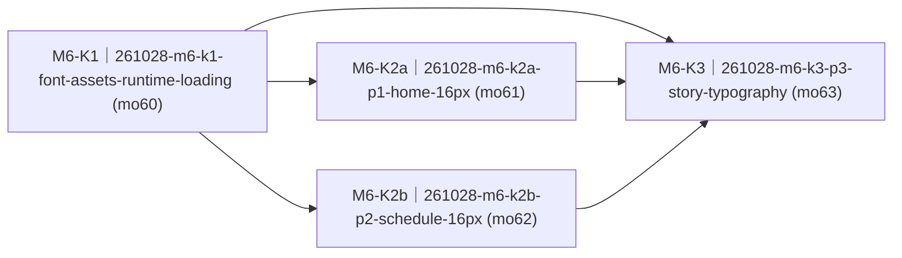

# 字体体系升级：正文 16px / 标题 20px / 字体资产运行时装载 · roadmap

> workstream：`261028-font-typography-scaleup` ｜ 设计权威：`PROPOSAL.md`（FROZEN v1.0，pin `sha1:af2e3627a8a2f254`）｜ 里程碑：`delivery/milestones/milestones.jsonl` M6-font-typography（state=planning）｜ 本件 ② 节由 `render-roadmap.mjs` 机械渲染、人工禁改；包集与达成状态权威 = board + `delivery/taskpackages/<changeId>/taskpackage.json`。

## ① 效果目标投影

**（投影自 `PROPOSAL.md` §1 业务目的清单，只引条目号与判据摘要。）**

| 目的# | 判据摘要（一行） | 权威指针 |
|---|---|---|
| 1 | 首页、故事列表、阅读正文、课表正文真机升 16px，不丢行、不破各页容量 | `PROPOSAL.md#§1` 目的 1 |
| 2 | 阅读标题 20px 水平居中、单行，超宽尾部省略且不压正文 | `PROPOSAL.md#§1` 目的 2 |
| 3 | 课表 pitch 19、带高 78/78/69、容量 4/4/3，超限静默截断不滚动 | `PROPOSAL.md#§1` 目的 3 |
| 4 | 故事列表长标题尾部省略，日期列完整可见 | `PROPOSAL.md#§1` 目的 4 |
| 5 | 16px/20px 全量 1bpp `.bin` 经 assets 运行时装载，缺资产回退 14px 不黑屏 | `PROPOSAL.md#§1` 目的 5 |
| 6 | 架构字体管线与实现一致，ADR-017 精确尺寸由实产回填，旧可读性 debt 已结项 | `PROPOSAL.md#§1` 目的 6 |
| 7 | 临时课程/事件 ※ 前缀全设备退役，改名称下 2px 下划线，★ 不动 | `PROPOSAL.md#§1` 目的 7 + spine q5 |

## ② 列车图（依赖 + 批次）

<!-- render-roadmap:begin -->
<!-- 本区块由 .claude/scripts/render-roadmap.mjs 机械渲染（workstream=261028-font-typography-scaleup，渲染时刻 2026-10-28T06:20:27.000Z）。
     人工禁改；渲染源唯一 = board + taskpackage JSON。全量重算、幂等。 -->
<!-- 编号读法：<WS>-<K|N><波次><并行字母?>（如 M1-K2a）——K=承重（被下游依赖或主干终点）、N=游离（无人等待的侧线）；
     波次=依赖深度+1（跨 workstream 外部前置不占波次）；同波次字母=并行占位序、非合并序。编号随依赖重渲染自动重算，确切依赖边以本图为准。 -->

| 编号 | changeId | mergeOrder | 达成状态 | deviation 裁定锚 |
|---|---|---|---|---|
| M6-K1 | 261028-m6-k1-font-assets-runtime-loading | 60 | pending（board: queued） | — |
| M6-K2a | 261028-m6-k2a-p1-home-16px | 61 | pending（board: queued） | — |
| M6-K2b | 261028-m6-k2b-p2-schedule-16px | 62 | pending（board: queued） | — |
| M6-K3 | 261028-m6-k3-p3-story-typography | 63 | pending（board: queued） | — |
<!-- render-roadmap:end -->

## ③ 每包条目

### 261028-m6-k1-font-assets-runtime-loading

- **mergeOrder**：60
- **完成后人能看到什么**：设备 assets 分区新增 16px 正文和 20px 标题两枚全量中文字体，探针页真机确实以新字号显示中文；即使 assets 缺失或损坏，设备也仍以原有 14px 正常开机、不黑屏。host 与设备读同一字体文件，后续三个页面包才有可信的共同底座。这是业务目的 5、6 的承载包。
- **回指**：资产/运行时底座切片，无单一 story 直接命中；回指 `PROPOSAL.md#§1` 目的 5、6 + `ADR-017` + 已归档 `ARQ-260831-small-cjk-1bpp-readability`。
- **demo 证据形态**：host runner 同源 cbin 装载与降级证据 + device build/assets 烧写 + 真机探针看屏照片、串口日志与缺 assets 开机轮。
- **达成状态**：pending

### 261028-m6-k2a-p1-home-16px

- **mergeOrder**：61
- **完成后人能看到什么**：首页「接下来/明天」文字大一号，但原有行数、日程分组和空态一项不少；临时事件不再被 ※ 占去名称宽度，而是在事件名下显示一条下划线。辅助条仍保持原字号。承载业务目的 1 的首页半与目的 7 的首页半。
- **回指**：`S-F1.1 · 常显首页看「接下来干嘛」`（AC1、AC2）+ `WF-F1-01` 临时事件下划线口径。
- **demo 证据形态**：host runner 行流/容量/下划线与三态回归 + device build + V8 design review；真机半并入 P3 终端轮，不独立占轮。
- **达成状态**：pending

### 261028-m6-k2b-p2-schedule-16px

- **mergeOrder**：62
- **完成后人能看到什么**：一周课表的课名大一号，上午/下午/晚上三带仍整齐不叠行；每格最多显示 4/4/3 门，超出照旧静默截断。临时课以课名下划线区分，★ 星标保留，课名不再被 ※ 挤占。承载业务目的 1、3、7 的课表面。
- **回指**：`S-F1.2 · 课表页看「一周总览」`（AC1、AC3、AC4）+ 补充规则容量 4/4/3 与静默截断口径。
- **demo 证据形态**：host runner 几何/容量/标记/restore 镜像 + device build + V8 design review + 一轮真机 pitch 19、容量、下划线与截断取证。
- **达成状态**：pending

### 261028-m6-k3-p3-story-typography

- **mergeOrder**：63
- **完成后人能看到什么**：故事列表和阅读正文大一号，长标题以省略号收尾而不压日期；阅读标题 20px 居中单行显示，正文每屏 3 个自然行，翻页不越屏。P0/P1/P2 全部合并后，本包用同一终端真机轮目击四页和缺 assets 降级，human 终判后 M6 才收口。承载业务目的 1、2、4 与原可选 P4/PROPOSAL §5。
- **回指**：`S-F2.1 · 看「星星记录本」列表`（AC1）+ `S-F2.3 · 回看记录`（AC1、AC2 与补充规则排版口径）。
- **demo 证据形态**：host runner 列表/阅读/省略/回退与 mcp 两消费点回归 + device build + V8 两帧 design review + M6 四页终端真机轮（照片、日志、human 终判）。
- **达成状态**：pending

## ④ 非目标与批次归属

- **调度**：P0 先行并阻塞所有页面包；P0→P1 另因 `kidpal_render_node.cc`/host seam 共享而串行。P1/P2 在 P0 后可并行，WIP limit=2；merge token 始终串行。P3 等 P0/P1/P2 全 merged 后 launch。
- **P4 裁定**：不独立成包，原真机观感轮并入 P3；P0 探针轮与 P2 pitch 轮保留各自配额，P1 不独立占轮。
- **不动**：键帽条/辅助条/查字窗/提醒弹窗/语音轮四态字号；分区表、OTA 字体下发、字体子集化、九档实验页与测试字体；`KSG_COURSE_CAP=84`、云端全量课程与 wire flags。
- **不做**：格内滚动或超限新提示；任何 `docs/contracts/**` 改动。若实现期发现必须让容量或新标记字段上网线，立即停并走 architect-reviewer 四分类 + `/arch-change`。
- **冻结面纪律**：P1/P2/P3 涉及的既有验收重基线均为 acceptance-author 收紧型留痕 supersede；冻结面优先，撤改法必红。
- **commit/launch**：门 1 GREEN + human 过目切法后，四件套先 commit 到专用 base ref（非 main），再由主线程做 launch prep；本拆包不 launch、不 merge。
