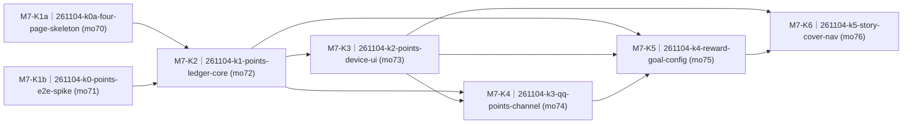

# 星星积分本与故事封皮（四页导航 + 金币账本）· roadmap

> workstream：`261103-star-points-story-cover` ｜ 设计权威：`PROPOSAL.md`（FROZEN v1.0，pin `sha1:4eca114e6998e14e`）｜ 里程碑：`delivery/milestones/milestones.jsonl` M7-star-points-cover（state=planning）｜ 本件 ② 节由 `render-roadmap.mjs` 机械渲染、人工禁改；包集与达成状态权威 = board + `delivery/taskpackages/<changeId>/taskpackage.json`。

## ① 效果目标投影

**（投影自 `PROPOSAL.md` §1 业务目的清单，只引条目号与判据摘要。）**

| 目的# | 判据摘要（一行） | 权威指针 |
|---|---|---|
| 1 | BOOT 首页→课表→积分本→故事封皮四点循环，封皮进入列表，阅读→列表→封皮→首页逐层返回 | `PROPOSAL.md#§1` 目的 1 |
| 2 | 积分主页同页显示余额、激活目标进度与最近三条，兑换或切目标后按新权威状态重画 | `PROPOSAL.md#§1` 目的 2 |
| 3 | 详细账本全量可及，删除有整屏确认，余额按剩余分录重算且负值如实显示 | `PROPOSAL.md#§1` 目的 3 |
| 4 | 完整语音句才记账并跳积分页，兑换只认激活目标且实际兑现后扣，随口事件不落账 | `PROPOSAL.md#§1` 目的 4 |
| 5 | QQ 可加/兑/查/删并复用同一账本规则，歧义普通报错，设备其他页不抢前台 | `PROPOSAL.md#§1` 目的 5 |
| 6 | 四预置可用且默认游乐场 40，QQ 管理唯一激活目标与 5–200 自定义奖励，设备刻度同步 | `PROPOSAL.md#§1` 目的 6 |
| 7 | 云端是唯一真相源，断网可见失败且不本地补写，恢复后数据可重建，故事星星与积分独立 | `PROPOSAL.md#§1` 目的 7 |
| 8 | 阅读 KEY 短按零响应、长按回列表且键帽正确，封皮改造不使其回归 | `PROPOSAL.md#§1` 目的 8 |

## ② 列车图（依赖 + 批次）

<!-- render-roadmap:begin -->
<!-- 本区块由 .claude/scripts/render-roadmap.mjs 机械渲染（workstream=261103-star-points-story-cover，渲染时刻 2026-11-04T03:20:58.457Z）。
     人工禁改；渲染源唯一 = board + taskpackage JSON。全量重算、幂等。 -->
<!-- 编号读法：<WS>-<K|N><波次><并行字母?>（如 M1-K2a）——K=承重（被下游依赖或主干终点）、N=游离（无人等待的侧线）；
     波次=依赖深度+1（跨 workstream 外部前置不占波次）；同波次字母=并行占位序、非合并序。编号随依赖重渲染自动重算，确切依赖边以本图为准。 -->

| 编号 | changeId | mergeOrder | 达成状态 | deviation 裁定锚 |
|---|---|---|---|---|
| M7-K1a | 261104-k0a-four-page-skeleton | 70 | pending（board: queued） | — |
| M7-K1b | 261104-k0-points-e2e-spike | 71 | pending（board: queued） | — |
| M7-K2 | 261104-k1-points-ledger-core | 72 | pending（board: queued） | — |
| M7-K3 | 261104-k2-points-device-ui | 73 | pending（board: queued） | — |
| M7-K4 | 261104-k3-qq-points-channel | 74 | pending（board: queued） | — |
| M7-K5 | 261104-k4-reward-goal-config | 75 | pending（board: queued） | — |
| M7-K6 | 261104-k5-story-cover-nav | 76 | pending（board: queued） | — |
<!-- render-roadmap:end -->

## ③ 每包条目

### 261104-k0a-four-page-skeleton

- **mergeOrder**：70
- **完成后人能看到什么**：BOOT 可以从首页、课表、新的积分占位页、故事页连续循环并回绕，底部变成四点且当前页实心正确。积分占位只显示“数据还在路上”的等待态，不伪造余额；故事仍是平级页，但列表、记录和阅读行为不变。阅读时 KEY 短按不再误开语音，长按能回列表且键帽正确。承载目的 1 的骨架半与目的 8。
- **回指**：`S-F6.1 · 看积分进度与最近记录`（AC4 数据未达半）+ `S-F2.1 · 看「星星记录本」列表`（AC1、AC2 回归）+ `S-F2.2 · 对话式引导记录`（AC1 回归）+ `S-F2.3 · 回看记录`（AC1、AC2）+ `TECH-261028-p3-reader-key-falls-to-session-toggle`。
- **demo 证据形态**：host runner 四页/页点/语境/阅读键与故事回归 + device build + V9 design review + 一轮真机逐页循环、逐页 source_page 和阅读键看屏/串口证据。
- **达成状态**：pending

### 261104-k0-points-e2e-spike

- **mergeOrder**：71
- **完成后人能看到什么**：孩子对真实设备说一句完整记账句后，积分页真能看到云端权威余额和事由；首选由家长从真实 QQ 发两笔同形 canary，第一笔证明设备在其他页不被抢屏，第二笔证明积分页在屏原地更新。若只能执行一笔，另一状态只能作为离线/宿主证据，不宣称两种状态都经真实 QQ 验证。最早与最新两条记录都能经分页消费端取到。它是新账本通路的真值验证，不代表完整账本、正式 UI 或正式 QQ 通道已经完成。承载目的 2/4/5/7 的最小通路。
- **回指**：`S-F6.3 · 设备语音记账与兑换`（AC1、AC2 最小通路）+ `S-F6.4 · QQ 家长记账与更正`（AC1、AC5 最小通路）+ `S-F6.2 · 浏览详细账本与删除误记`（AC1 首尾分页 canary）+ `NFR-PERF-4 · 记账反馈时延`。
- **demo 证据形态**：server/host 离线证据 + `spike-evidence.md` 真实设备语音与首选两笔同形真实 QQ 的状态化时间线、首尾分页、canary token 关联的 front/设备/引擎日志和看屏照片；K0a 合并后 host build、device build 与真机终验。若仅一笔，另一状态只作离线/宿主证据。
- **达成状态**：pending

### 261104-k1-points-ledger-core

- **mergeOrder**：72
- **完成后人能看到什么**：语音和 QQ 写入都进入同一云端账本，重复网络重试不会多记，删除误记后余额和每条前后余额会重算；即使删除导致负余额也保留事实，后续兑换仍按目标分值和余额约束执行。完整历史能通过稳定分页逐页取到，断网不会在设备偷偷补写。承载目的 3、7 的云端核心及目的 4/6 的规则底座。
- **回指**：`S-F6.2 · 浏览详细账本与删除误记`（AC1、AC4）+ `S-F6.3 · 设备语音记账与兑换`（AC3、AC4、AC5、AC6）+ `S-F6.5 · 奖励场景与激活目标配置`（AC1、AC2、AC4 存储半）+ `NFR-OFF-1 · 离线边界`。
- **demo 证据形态**：server pytest 原子写/重算/兑换/删除/两类幂等/目标存储与 keyset 变异证据 + 真实消费端分页和权威状态复核；不单独占真机 UI 配额。
- **达成状态**：pending

### 261104-k2-points-device-ui

- **mergeOrder**：73
- **完成后人能看到什么**：孩子翻到积分本能看到余额、目标进度和最近三条；空账、数据未达、负余额和超过目标都各有正确画面。双击进入详细账本可逐页看全历史，长按选中项出现整屏删除确认，删除后显示权威新余额。完整语音句会落账并跳页，随口事件不记账，金额不对或断网会得到明确反馈，重启后数据能恢复。承载目的 2、3、4、7 的设备闭环。
- **回指**：`S-F6.1 · 看积分进度与最近记录`（AC1–AC6）+ `S-F6.2 · 浏览详细账本与删除误记`（AC1–AC5）+ `S-F6.3 · 设备语音记账与兑换`（AC1–AC6）+ `NFR-OFF-1/NFR-PERF-4`。
- **demo 证据形态**：host runner + server pytest + device build + 六张 V9 帧 design review + 一轮真机完整/不完整语音、兑换、断网、删除致负、冷启动和 restore 三源证据。
- **达成状态**：pending

### 261104-k3-qq-points-channel

- **mergeOrder**：74
- **完成后人能看到什么**：家长在 QQ 里可以给孩子加分、兑现奖励、查真实余额/目标/最近记录，并用稳定 id 或最近列表序号删除误记。说错格式或指认不清时会立即收到普通文字说明，不会卡在追问里；设备在其他页只更新数据，在积分页则原地刷新。承载目的 5 及目的 3/4 的家长通道。
- **回指**：`S-F6.4 · QQ 家长记账与更正`（AC1–AC5）+ `S-F6.3 · 设备语音记账与兑换`（AC3、AC4、AC5 同规则半）+ `S-F6.2 · 浏览详细账本与删除误记`（AC4 删除重算半）。
- **demo 证据形态**：server/skill 离线验收 + 真实 QQ 加兑查删、歧义与重复输入记录 + 设备看屏/串口、front/points/QQ 日志对账；按 NFR-PERF-4 记录 QQ 消息到积分页原地刷新的实测时延，不写死阈值。
- **达成状态**：pending

### 261104-k4-reward-goal-config

- **mergeOrder**：75
- **完成后人能看到什么**：孩子可以看到巧克力、看电影、游乐场和礼物四种目标美术，家长也能从 QQ 新增一个带通用旗标的自定义奖励并切换激活。目标从 40 切到其他分值后，进度线刻度随之变化，之后兑换只认新分值；切换本身不会扣分，激活中的自定义目标必须先切换才能删除。承载目的 6 及目的 2/4 的目标联动。
- **回指**：`S-F6.5 · 奖励场景与激活目标配置`（AC1–AC4）+ `S-F6.1 · 看积分进度与最近记录`（AC2、AC3）+ `S-F6.3 · 设备语音记账与兑换`（AC3）+ `S-F6.4 · QQ 家长记账与更正`（AC4、AC5）。
- **demo 证据形态**：资产管线/KAP1 机检 + server pytest + host runner + 真实 QQ 配置全过程 + 一轮真机场景标、刻度、大分值与 restore 看屏证据；切目标刷新顺带记录同一“QQ 消息→积分页原地刷新”实测时延字段，不写死阈值。
- **达成状态**：pending

### 261104-k5-story-cover-nav

- **mergeOrder**：76
- **完成后人能看到什么**：BOOT 第四页先出现一本有书封、标题和现存星星数的「星星记录本」封皮，按 KEY 才进入列表；从阅读连续长按会逐层回到列表、封皮、首页。语音“打开故事”也只停在封皮，路过不会自动开录。封皮和列表计数同步，故事记录、阅读、删除和盖章行为不因下沉而改变；正文未留存且取不回时有可见提示，不显示别篇。承载目的 1 的封皮分层并复证目的 8。
- **回指**：`S-F2.6 · 故事封皮与分层导航`（AC1–AC4）+ `S-F2.1 · 看「星星记录本」列表`（AC1–AC7 回归）+ `S-F2.2 · 对话式引导记录`（AC1 入口回归）+ `S-F2.3 · 回看记录`（AC1、AC2）+ `S-F2.4 · 星星保存成就盖章`（AC2 现存计数半）。
- **demo 证据形态**：host/server 导航与 story_list 共享帧验收 + 资产管线/device build + V9 design review + 一轮真机四页与故事层级并集；跨包账本/QQ 联合收口由主线程另组织。
- **达成状态**：pending

## ④ 非目标与批次归属

- **调度与合并序**：仅 K0a ∥ K0 为 WIP=2 并行对，mergeOrder=70/71，K0a 必须先合。两包 merged 后 WIP=1，K1→K2→K3→K4→K5，mergeOrder=72→76；merge token 始终串行。K0 的并行开发只覆盖服务端与新增 points 文件，其 host build、device build、真机终验和 ready-to-merge 均须在 K0a 合并后重取基线执行。
- **K0a/K0 文件边界**：两包唯一共享构建清单是 `firmware/main/test/host_app/main/CMakeLists.txt`，不再宣称文件零重叠。K0a 先落该清单并留下 P3 接管缝，K0 在 K0a merged 后追加自己的测试/实现登记；其余 K0a 文件不改。后续 K2 在 K0/K1 合并基线上替换为正式积分页。
- **共享面串行对账**：TECH-261022-p3-record-session-state-churn 的独立承接包与本列车共享 keybar、故事页和 front 文件，合并时须复跑双方冻结验收，但不吸收其 scope。当前 board 两个对应承接包均 merged；若后续重开或新增相关包，须先由主线程重排 merge order。
- **debt 消费**：TECH-261028 只由 K0a 修复，K5 只回归；TECH-261030 只构成“禁 ask_user”硬约束，TECH-261012 只提供 QQ skill 工程先例，均不借本列车宣称结项。故事星星与积分始终是两套独立数据。
- **冻结面纪律**：三页枚举、数字 source_page、旧 story_list restore/P3 消费断言与 landed spec/契约的差距，均由对应包的 acceptance-author 收紧型留痕重锚；冻结面优先，本拆包不预批撤改法。所有包不得修改 `docs/contracts/**`、requirements 或 architecture，发现新线格式或语义缺口立即走逃生门。
- **非目标**：不做越目标庆祝演出、惩罚性扣分、设备语音删除、新语音加分护栏、“待兑现”或“暂无目标”独立页、本地离线写队列、新外部供应商、多设备/多孩子身份、重开引擎 Intent 或合并故事星星与积分。
- **commit/launch**：门 1 GREEN + human 过目切法后，四件套与 task_plan 先 commit 到专用 base ref（非 main），再由主线程做 launch prep；本拆包不 launch、不 merge。K0 的真实 QQ 最小 producer 预评未通过时不得点火。
- **workstream 收口**：K5 只承担导航并集 owner。PROPOSAL §5 的跨包真机与真实 QQ 联合收口由主线程在七包后另组织，不把跨包行为留成无 owner 项，也不以 K5 单包合并自动宣告整列车完成。
