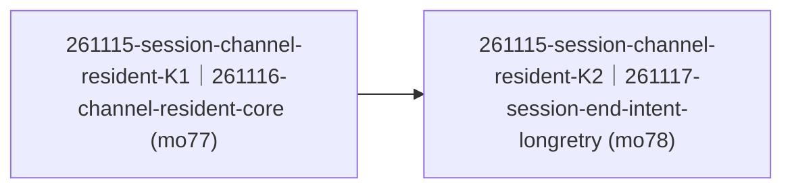

# 语音会话与 WS 通道生命周期解耦 · roadmap

> workstream：`261115-session-channel-resident` ｜ 设计权威：`PROPOSAL.md`（FROZEN v1.0，pin `sha1:bc53e2b9d5cf772d`）｜ 本件 ② 节与达成状态列由 `render-roadmap.mjs` 投影渲染，② 节人工禁改。

## ① 效果目标投影

| 目的# | 判据摘要（一行） | 权威指针 |
|---|---|---|
| 1 | 连续 5 次「结束→再说话」每次进聆听 ≤1s、无重建 burst | `PROPOSAL.md#§1` 目的 1 |
| 2 | 闲置 >5 分钟后首按键仍走温通道、不丢首按 | `PROPOSAL.md#§1` 目的 2 |
| 3 | 说「拜拜」真正结束会话（麦克风关、按 OQ3=c 回落、通道常驻） | `PROPOSAL.md#§1` 目的 3 |
| 4 | 60s 静默自动关闭真机发生；连续讲 >60s 不被误收 | `PROPOSAL.md#§1` 目的 4 |
| 5 | 断网/重启 front 超过 15 秒后自愈；离线期按键与唤醒补投不丢 | `PROPOSAL.md#§1` 目的 5 |
| 6 | 会话间隙提醒仍必达且出音（S-F1.4 + ADR-003） | `PROPOSAL.md#§1` 目的 6 |

## ② 列车图（依赖 + 批次）

<!-- render-roadmap:begin -->
<!-- 本区块由 .claude/scripts/render-roadmap.mjs 机械渲染（workstream=261115-session-channel-resident，渲染时刻 2026-11-15T23:40:52.175Z）。
     人工禁改；渲染源唯一 = board + taskpackage JSON。全量重算、幂等。 -->
<!-- 编号读法：<WS>-<K|N><波次><并行字母?>（如 M1-K2a）——K=承重（被下游依赖或主干终点）、N=游离（无人等待的侧线）；
     波次=依赖深度+1（跨 workstream 外部前置不占波次）；同波次字母=并行占位序、非合并序。编号随依赖重渲染自动重算，确切依赖边以本图为准。 -->

| 编号 | changeId | mergeOrder | 达成状态 | deviation 裁定锚 |
|---|---|---|---|---|
| 261115-session-channel-resident-K1 | 261116-channel-resident-core | 77 | pending | — |
| 261115-session-channel-resident-K2 | 261117-session-end-intent-longretry | 78 | pending | — |
<!-- render-roadmap:end -->

## ③ 每包条目

### 261116-channel-resident-core

- **mergeOrder**：77
- **完成后人能看到什么**：孩子每轮对话结束后再按键，设备立刻（≤1s）进聆听，不再有「按了没反应」；放着几分钟不用，第一下按键也照样立刻响应；孩子走开后设备在 60 秒无语音时自动收起麦克风；会话间隙的提醒照常弹窗、照常出声。整轮不再出现每次结束都重建连接带来的后台 burst。
- **回指**：`S-F1.4 · 日程提醒`（AC1、AC3）；`requirements §2.1` 结束三通道；`requirements §2.3` 录音态子态按键口径；`S-F2.2 · 对话式引导记录`（AC4）。整改型缺陷锚 = `TECH-261114` / `TECH-261012`（KPLOG029 实测）。
- **demo 证据形态**：host runner（设备 C 验收）+ server pytest（front 验收）+ device build + 一轮真机轮 A（human 持板）。
- **达成状态**：pending（board / taskpackage 为准）

### 261117-session-end-intent-longretry

- **mergeOrder**：78
- **完成后人能看到什么**：孩子说「拜拜/不用了」时，小伴道别后真正把会话收起来、麦克风关闭、回到原来的页面；网络断掉或服务端重启一阵子之后，设备自己恢复，不用孩子再按一次；离线期间按下的键或喊的唤醒词也不会白丢。
- **回指**：`S-F1.4 · 日程提醒`（离线期必达）；`requirements §2.1` 结束通道②③；`requirements §2.2` 四态演出回归。整改型缺陷锚 = `TECH-261014-session-end-channels-unwired` / `TECH-261014-autoconnect-gives-up-silently`。
- **demo 证据形态**：host runner + server pytest + device build + 一轮真机轮 B（human 持板）。
- **达成状态**：pending（board / taskpackage 为准）

## ④ 非目标与批次归属

- **不改引擎代码与 config**：`engine-patch/**` 与 ECS `core/**` 零 diff；引擎 24h 日切接受为唯一剩余重建窗口。
- **不做会话边界注入、不新立会话上下文机制**：共享短上下文由 ADR-015 承载（重评触发见 PROPOSAL §6 留根 2）。
- **不改需求语义**：60s 阈值、结束三通道、录音态按键口径、记录会话不适用 60s 照现行 requirements。
- **不动既有帧形状**：不新增 view、display 白名单仍 9。
- **远程发布不在本 workstream 内**：两包合并本地 main + 真机轮通过后，由主线程走 `release-pr.mjs --publish`，PR 合并仍 human。
- **`docs/requirements.md:48` ⚠️ 对账注记刷新**：跨包事项，主线程在列车收口时路由（实现包 integrator docs-delta 或需求面对账小批）。