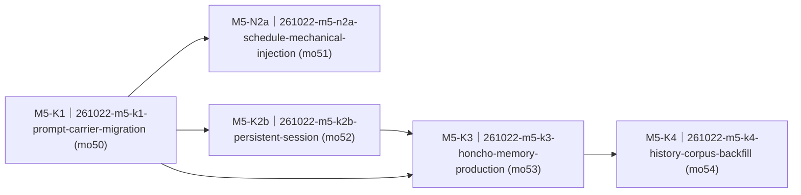

# 设备语音链路「越用越聪明」整体重构（device-memory-overhaul）· roadmap

> workstream：`device-memory-overhaul` ｜ 设计权威 = [PROPOSAL.md](PROPOSAL.md)（FROZEN v1.0，pin `sha1:b03fdcbb2150cbfa`）+ [../../review/261022-arch-review-device-memory-prompt-overhaul/PROPOSAL.md](../../review/261022-arch-review-device-memory-prompt-overhaul/PROPOSAL.md)（FROZEN v1.1）｜ 里程碑注册表行 = `delivery/milestones/milestones.jsonl` M5-device-memory（state=planning）｜ 本件 ② 节由 `render-roadmap.mjs` 机械渲染、人工禁改；包集与达成状态权威 = board + `delivery/taskpackages/<changeId>/taskpackage.json`。

## ① 效果目标投影

**（投影自 PROPOSAL §1 业务目的清单，只引条目号 + 一句判据摘要 + 指针，不复制正文。）**

| 目的# | 判据摘要（一行） | 权威指针 |
|---|---|---|
| 1 | 单轮 DeepSeek `prompt_tokens` 从 22,116 降到 ≤11,000（≥50%），cache hit 覆盖稳定前缀（v11 迁 AGENTS.md 后目标翻倍量级） | `PROPOSAL.md#§1` 目的 1 |
| 2 | 新 WS、新会话问「我最喜欢的颜色 / 我的小狗叫什么」答对（全新 user id 对照答不出） | `PROPOSAL.md#§1` 目的 2 |
| 3 | 注入家长姓名/电话/家庭安排后，画像与答复零命中；隐私负向探针 100% 不回忆 | `PROPOSAL.md#§1` 目的 3 |
| 4 | 受控 ≥20 轮提问零工具调用也不编造，答案与 `kidpal/schedule.md` 逐日一致 | `PROPOSAL.md#§1` 目的 4 |
| 5 | kidpal agent 可见工具 = 4 项（read/write/exec/web_search），Tooling 章收缩、57KB schema 消失 | `PROPOSAL.md#§1` 目的 5 |
| 6 | prep 税/内存压力复测有 2C/4G 基线读数，无 event_loop_delay 38s 级退化 | `PROPOSAL.md#§1` 目的 6 |

## ② 列车图（依赖 + 批次）

<!-- render-roadmap:begin -->
<!-- 本区块由 .claude/scripts/render-roadmap.mjs 机械渲染（workstream=device-memory-overhaul，渲染时刻 2026-10-22T14:32:54.474Z）。
     人工禁改；渲染源唯一 = board + taskpackage JSON。全量重算、幂等。 -->
<!-- 编号读法：<WS>-<K|N><波次><并行字母?>（如 M1-K2a）——K=承重（被下游依赖或主干终点）、N=游离（无人等待的侧线）；
     波次=依赖深度+1（跨 workstream 外部前置不占波次）；同波次字母=并行占位序、非合并序。编号随依赖重渲染自动重算，确切依赖边以本图为准。 -->

| 编号 | changeId | mergeOrder | 达成状态 | deviation 裁定锚 |
|---|---|---|---|---|
| M5-K1 | 261022-m5-k1-prompt-carrier-migration | 50 | pending（board: queued） | — |
| M5-N2a | 261022-m5-n2a-schedule-mechanical-injection | 51 | pending（board: queued） | — |
| M5-K2b | 261022-m5-k2b-persistent-session | 52 | pending（board: queued） | — |
| M5-K3 | 261022-m5-k3-honcho-memory-production | 53 | pending（board: queued） | — |
| M5-K4 | 261022-m5-k4-history-corpus-backfill | 54 | pending（board: queued） | — |
<!-- render-roadmap:end -->

## ③ 每包条目

### 261022-m5-k1-prompt-carrier-migration

- **mergeOrder**：50
- **完成后人能看到什么**：小伴的「规矩」不再每轮随请求塞进引擎，而是长驻在 OpenClaw 工作区的 AGENTS.md 里——每轮只送一小块动态上下文（时间/日期、课表摘要），回合更轻、更省、响应更快；小伴手上也不再挂着几十个用不上的工具，只剩读、写、执行、联网搜索四项。这是后续记忆与课表注入的地基。
- **回指**：重构型，结构性痛点锚 = `PROPOSAL.md#§2`「结构性痛点（重构型）」+ `TECH-261022` 证据 2/5；静态语义为 S-F5.1 补充规则的承载位置（守则内容归 P3）。
- **demo 证据形态**：host runner 输出（pytest 验收 + 静态接线/锚集断言）+ 部署后 live（`verify-deploy.sh` 绿、单轮 prompt_tokens ≤11,000、工具列表 = 4 项）。
- **达成状态**：pending

### 261022-m5-n2a-schedule-mechanical-injection

- **mergeOrder**：51
- **完成后人能看到什么**：问「明天有什么课」「后天呢」时，小伴不再假装翻课表然后凭印象编造——同一份课表内容每轮都在它眼前，零工具调用也能答对，答案与家长录入的课表逐日一致；课表没覆盖到的日期它会诚实说查不到。
- **回指**：`S-F1.3 · 语音问课表（AC1）` + 缺陷证据锚 `TECH-261018-schedule-read-compliance-residual`；业务目的 4。
- **demo 证据形态**：host runner 输出（注入内容 == `parse_schedule_md` / `items_for_date` 同日派生）+ loopback 探针 ≥20 轮零编造 + 真机轮（M5 收口轮 owner，human 持板抽问今天/明天/后天）。
- **达成状态**：pending

### 261022-m5-k2b-persistent-session

- **mergeOrder**：52
- **完成后人能看到什么**：小伴终于「记得刚才聊到哪」——同一台设备上，换一次唤醒、隔天再来，它都接着上次的话题说，而不是每次从零开始；引擎不再每轮把整段历史重发一遍，跨会话连续性由 OpenClaw 服务端持久会话承载。
- **回指**：`S-F5.1 · 记住孩子说过的事（AC1、AC2）`——上下文底座半（记忆画像本身归 P3）。
- **demo 证据形态**：host runner 输出（payload 形状 + 两轮追问连续性探针 + 省略 user 降级负锚）+ 部署后 live（新 WS 新会话回忆复证、引擎日志补丁标记行）。
- **达成状态**：pending

### 261022-m5-k3-honcho-memory-production

- **mergeOrder**：53
- **完成后人能看到什么**：小伴真的开始认识孩子——孩子说过喜欢紫色、小狗叫豆豆、同学叫王一诺，隔天新会话里问起都答得上来；同时家长的姓名、电话、家庭安排不会被记住、也不会被套问出来；设备自己流程触发的「整理/引导」回合不会混进孩子的画像。记忆服务全部跑在 ECS 本机 loopback 上，故障时只是不记得，不影响聊天。
- **回指**：`S-F5.1 · 记住孩子说过的事（AC2、AC3、AC4、AC5）` + `NFR-PRIV-1` + `NFR-SEC-2 ⑤`；业务目的 2、3、6。
- **demo 证据形态**：host runner 输出（marker 探针 DB/日志双证 + seeded 负向探针集 + 降级路径 + 声明式 patch 幂等/回滚）+ 部署后 live 真机轮（跨会话回忆 / 隐私套问不复述）+ 资源读数回填 debt。
- **达成状态**：pending

### 261022-m5-k4-history-corpus-backfill

- **mergeOrder**：54
- **完成后人能看到什么**：孩子过去几个月聊过的事不是白聊的——历史语料一次性补进记忆后，问起旧事（比如以前提过的同学名字）小伴也答得上来，和最近聊的事一视同仁。补录可重复跑、不会重复记，跑前跑后有数量报告，必要时可清库重来。
- **回指**：`S-F5.1 · 记住孩子说过的事（AC5 历史照记）` + `TECH-261022` 证据 1；业务目的 2 的历史面。
- **demo 证据形态**：host runner 输出（幂等二次跑零增量 + 计数报告 + 回滚脚本离线契约）+ live 运维（human 在 ECS 全量跑 + 计数报告过目 + 清库回滚演练）+ 收口轮抽问旧事。
- **达成状态**：pending

## ④ 非目标与批次归属

- **引擎 Intent 维持 nointent、thinking 维持关闭、分回合 thinking 不纳入本批**（human 2026-10-22 裁；ARQ-260907 根因在案）。
- **不做 OpenClaw 替换 / 自研记忆层**；不做多设备 / 多孩子身份体系（先设备级 peer，换设备 = 新 peer，身份体系另立批）。
- **不触碰 display E1 / B1 课表 MD / §三提醒 / §四私有消息帧的线格式**；课表机械注入只改「谁把 B1 内容喂给模型」，不改 B1 结构。
- **不修改历史 prompt 版本文件**（v1–v11 原地冻结、可 diff）；不新建 v12 双件、不新建 `server/deploy/prompts/` 平行目录（OQ-8）。
- **记忆保留 / 备份 / 删除**：删除 = 运维手工、无自助界面；备份 = 不备份靠重建（OQ-10 human 终裁）。
- **跨批前置**：需求面 requirements v1.67 / 架构面 FROZEN v1.1 landing / 契约包随批原子落——三项已全部满足（见 decision-coverage.json `launchPreconditions` LP1–LP3）；门 1 + human 过目切法 + commit-before-launch 为 launch 前剩余门（LP4–LP5）。
- **收口轮归属**：P5 为最后一个行为切片的收口轮 owner；P4 的前后计数报告同轮对账；真机配额默认仅收口轮。
