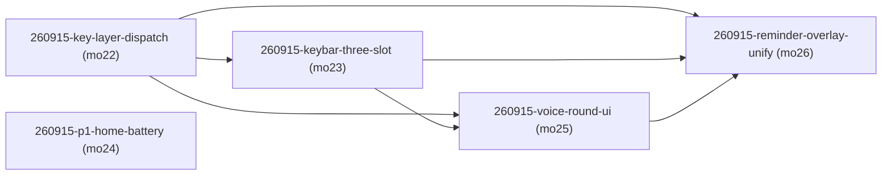

# 阶段一·首页 + 百科问答（M1-home-qa）· roadmap

> workstream：`m1-home-qa` ｜ 设计权威 = `docs/requirements.md` §6 阶段一（v1.42 路线图）+ §2 共享底座 + F1/F4 story 全集（story 语义权威恒为 requirements 现文）｜ 里程碑注册表行 = `delivery/milestones/milestones.jsonl` M1-home-qa（state=in_delivery）｜ 本件 ② 节由 `render-roadmap.mjs` 机械渲染、人工禁改；包集与达成状态权威 = board + `delivery/taskpackages/<changeId>/taskpackage.json`。
> 拆包输入 = 里程碑注册表 M1-home-qa nextAction 四块（无 PROPOSAL 输入，`sourceType=delivery-story`）。

## ① 效果目标投影

**（投影自 milestones.jsonl M1-home-qa nextAction 四块，每块一句人可观察判据 + 指针；不复制 spec 正文。）**

| 目的# | 判据摘要（一行） | 权威指针 |
|---|---|---|
| 1 | 按键手感与 §2.3 权威矩阵一致：覆盖层内 BOOT 不误翻页、KEY 长按逐层返回——不做则后续每页返工 | requirements §2.2 键帽条行 + §2.3 全矩阵（键位实现侧对账 ①⑤） |
| 2 | 孩子瞟一眼首页就知道「接下来干嘛」：接下来主体 + 辅助条小图标 + 倒计时 + 真实电量（ADC 接线后低电闪烁真机可见） | S-F1.1 · 常显首页看「接下来干嘛」（AC1–AC4） |
| 3 | 对话主路径演出完整：孩子说完即弹思考页、说的话逐句回显、答复长文滚动看完、播报中 KEY 一按就停 | S-F4.1 · 语音问答（AC1–AC2）+ S-F1.3 · 语音问课表（AC1/AC3，问答框口径）+ §2.2 状态表 |
| 4 | 提醒弹窗与语音轮四态同一版式骨架、最高层覆盖、按键语义与矩阵一致 | S-F1.4 · 日程提醒（AC1–AC6）+ §2.2 提醒行 |

## ② 列车图（依赖 + 批次）

<!-- render-roadmap:begin -->
<!-- 本区块由 .claude/scripts/render-roadmap.mjs 机械渲染（workstream=m1-home-qa，渲染时刻 2026-09-15T02:40:16.919Z）。
     人工禁改；渲染源唯一 = board + taskpackage JSON。全量重算、幂等。 -->

| changeId | mergeOrder | 达成状态 | deviation 裁定锚 |
|---|---|---|---|
| 260915-key-layer-dispatch | 22 | pending（board: queued） | — |
| 260915-keybar-three-slot | 23 | pending（board: queued） | — |
| 260915-p1-home-battery | 24 | pending（board: queued） | — |
| 260915-voice-round-ui | 25 | pending（board: queued） | — |
| 260915-reminder-overlay-unify | 26 | pending（board: queued） | — |
<!-- render-roadmap:end -->

## ③ 每包条目

### 260915-key-layer-dispatch

- **mergeOrder**：22
- **完成后人能看到什么**：在提醒弹窗、查字窗、语音轮演出等任何覆盖层里按 BOOT，屏幕不再「顺手翻到下一页」，而是关掉覆盖层回到打开覆盖层前的原页；在主页面上 KEY 长按回到上一层（当前页集下 = 回首页）。这是后续所有页内键位工作的地基——键位手感从此与 spec 权威矩阵对齐。
- **回指**：（无 story——共享底座键位对账项）`docs/requirements.md` §2.3 按键手势（键位实现侧对账 ①⑤）+ §2.2 键帽条行
- **demo 证据形态**：host runner 输出 + 真机轮（human 持板：覆盖层 BOOT 不翻页、KEY 长按返回）
- **达成状态**：pending

### 260915-keybar-three-slot

- **mergeOrder**：23
- **完成后人能看到什么**：屏幕底部常驻通栏键帽条从单行居中文案升级为三槽（左 KEY 提示 · 中页点 · 右 BOOT 提示），左右槽文案随当前态切换（聆听「说完啦」等冻结映射），进入覆盖层时页点消失、左右槽照常提示——基座 chrome 手感与设计稿 v4 `comp-keybar` 对齐。
- **回指**：（无 story——共享底座键帽条）`docs/requirements.md` §2.2 键帽条行（comp-keybar）+ §2.4 页面结构
- **demo 证据形态**：模拟器截图 + host runner + 真机轮
- **达成状态**：pending

### 260915-p1-home-battery

- **mergeOrder**：24
- **完成后人能看到什么**：首页新版式——辅助条各项图标前置（联网小标打头、温/湿/电各带小图标、湿度不裸数字挨电池）；电量 ADC 三处死成员接线（板类 `adc1_handle`/`cali_handle`/`vbat_status` + `GetBatteryLevel` 实装 + 渲染节点电池注入缝，`s_battery_pct` 不再恒 100）——真机电量首次显示真实值，低电时电池图标每秒闪、充电即停，断网时联网小标变 WiFi 斜杠。
- **回指**：`S-F1.1 · 常显首页看「接下来干嘛」（AC1–AC4）`
- **demo 证据形态**：模拟器截图 + host runner + 真机轮（human 持板：ADC 实测电量/低电闪烁）
- **达成状态**：pending

### 260915-voice-round-ui

- **mergeOrder**：25
- **完成后人能看到什么**：语音会话演出补齐成完整三态演出 + 打断手感：孩子说完一句，思考页（pose-think + 飘问号）与状态切换同一时刻弹出（真机首次可弹）；说话逐句回显在「我在听！」下方（超屏滚动）；答复长文在问答框滚动看完（回引 NFR-READ-1）；播报中按 KEY 立即停播转聆听——对话主路径不再「黑箱等待」。
- **回指**：`S-F4.1 · 语音问答（AC1–AC2）` + `S-F1.3 · 语音问课表（AC1/AC3，问答框口径）` + §2.2 状态表（聆听/思考/播报三行）
- **demo 证据形态**：模拟器截图 + host runner + 真机轮
- **达成状态**：pending

### 260915-reminder-overlay-unify

- **mergeOrder**：26
- **完成后人能看到什么**：到点提醒弹窗与语音轮四态同一版式骨架（左小伴 pose-jump + 右大字事项/时间），弹出时压过查字窗/录音态/播报中等一切前台内容（最高层）；置顶期间按键不穿透底层窗口；录音中到达的提醒排队延后、录音会话结束立刻弹；弹窗驻留到按键不自动消失；同一提醒不重复弹——三段阶梯提醒的手感与 §2.2 权威口径一致。
- **回指**：`S-F1.4 · 日程提醒（AC1–AC6）`
- **demo 证据形态**：模拟器截图 + host runner + 真机轮
- **达成状态**：pending

## ④ 非目标与批次归属

- **happy-flow-host-capture 收尾**：在办包（`delivery/changes/dev/260913-happy-flow-host-capture/` open，独立 planner 闭环），不随本批重拆——M1 里程碑收口前由其自身闭环收尾，本 workstream 只挂账不承载。
- **60 秒 / 120 秒 timer 生产者接线**（requirements §2.1 60 秒超时对账 + §7 开放问题 7 双阈值）：与语音轮状态机同 seam 但非演出面，留给 M1 后续批次拆包（deferred，非 dropped）。
- **页循环 4→3 / 撤 P4 常驻页 / 页点 4→3 对账**：归 M2 查字窗阶段（keybar 页点数量 deviation 在此对账收回）。
- **P3 键位族 v1.47**（录音态 BOOT 丢弃、P3 列表删除确认子态、单双击消歧）：随 M4 星星记录本阶段落地。
- **课表数据接首页**：归 M3 与阶段一合流（决策 26 链路）；本批首页「接下来」按现数据口径验收。
- **spec 面零修订**：本批所有包 `docsSyncRequired=false`；实现中发现与 requirements 冲突走 spec-lane 逃生门（Track B），不预先立项、不在 Pod 内改 spec。
