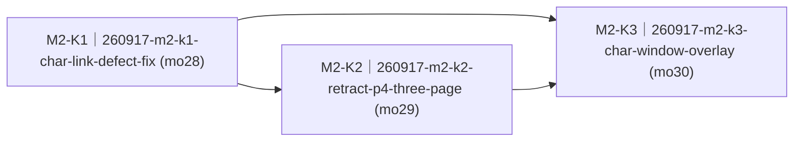

# 阶段二·查字窗（live 链路修复 + 页→窗改造）（M2-char-window）· roadmap

> workstream：`m2-char-window` ｜ 设计权威 = `docs/requirements.md` F3 全节（v1.55 播报口径）+ §2.2 状态表查字窗行/键帽条行 + §2.3/§2.4 + NFR-PERF-2（story 语义权威恒为 requirements 现文）｜ 里程碑注册表行 = `delivery/milestones/milestones.jsonl` M2-char-window（state=planning）｜ 本件 ② 节由 `render-roadmap.mjs` 机械渲染、人工禁改；包集与达成状态权威 = board + `delivery/taskpackages/<changeId>/taskpackage.json`。
> 拆包输入 = 里程碑注册表 M2-char-window nextAction 两块（无 PROPOSAL 输入，`sourceType=delivery-story`）。

## ① 效果目标投影

**（投影自 milestones.jsonl M2-char-window nextAction 两块，每块一句人可观察判据 + 指针；不复制 spec 正文。）**

| 目的# | 判据摘要（一行） | 权威指针 |
|---|---|---|
| 1 | live 端说「勇怎么写」米字格 9 笔完整逐笔演示不崩不缺笔（两缺陷修复 + NFR-PERF-2 live 复测 5 秒档在档）——NFR-PERF-2 黄灯转绿前提 | S-F3.1 · 语音查字并看笔顺演示（可行性注记两缺陷）+ NFR-PERF-2 |
| 2 | BOOT 翻页只剩 3 页循环、页点 3 点，翻页序与 spec P1→P2→P3 一致 | §2.4 行 186（P4 撤销）+ §2.2 键帽条行 + 行 166 ②（页序漂移） |
| 3 | 说「某个字怎么写」，当前页上弹出查字窗（会话内覆盖窗）：米字格演示 + 右栏拼音/共 N 画/部首/组词全四行，KEY 短按重播、长按关窗，5 分钟无操作自动关窗回原页 | S-F3.1 AC1–AC4 + S-F3.2 AC1 + S-F3.3 AC1–AC2 + §2.2 查字窗行 |

## ② 列车图（依赖 + 批次）

<!-- render-roadmap:begin -->
<!-- 本区块由 .claude/scripts/render-roadmap.mjs 机械渲染（workstream=m2-char-window，渲染时刻 2026-09-17T15:31:25.987Z）。
     人工禁改；渲染源唯一 = board + taskpackage JSON。全量重算、幂等。 -->
<!-- 编号读法：<WS>-<K|N><波次><并行字母?>（如 M1-K2a）——K=承重（被下游依赖或主干终点）、N=游离（无人等待的侧线）；
     波次=依赖深度+1（跨 workstream 外部前置不占波次）；同波次字母=并行占位序、非合并序。编号随依赖重渲染自动重算，确切依赖边以本图为准。 -->

| 编号 | changeId | mergeOrder | 达成状态 | deviation 裁定锚 |
|---|---|---|---|---|
| M2-K1 | 260917-m2-k1-char-link-defect-fix | 28 | pending（board: queued） | — |
| M2-K2 | 260917-m2-k2-retract-p4-three-page | 29 | pending（board: queued） | — |
| M2-K3 | 260917-m2-k3-char-window-overlay | 30 | pending（board: queued） | — |
<!-- render-roadmap:end -->

## ③ 每包条目

### 260917-m2-k1-char-link-defect-fix

- **mergeOrder**：28
- **完成后人能看到什么**：live 端说「勇怎么写」，查字演示不再崩溃（板端 LVGL 栈定容 + 动画帧去大栈数组），示范字 9 笔一笔不少（SVG 解析器补 C 命令——此前 6 笔含 C 被整笔丢弃、字形残缺）；custom_lcd_display 里那次跳过流程的 16K 栈一次性补丁被正式定容收编。这是 NFR-PERF-2 黄灯转绿与页→窗改造的共同地基。
- **回指**：`S-F3.1 · 语音查字并看笔顺演示`（可行性注记两缺陷）+ `NFR-PERF-2 · 查字端到端延迟`（AC 号集：S-F3.1 AC1–AC2 承载面；live 复测归 K3 设备轮）
- **demo 证据形态**：host runner（C 命令齿 RED→GREEN + 既有命令回归齿）+ device build 闸；真机半 deferred 归 K3 设备轮
- **达成状态**：pending

### 260917-m2-k2-retract-p4-three-page

- **mergeOrder**：29
- **完成后人能看到什么**：BOOT 翻页从 4 页变 3 页循环（首页→课表→故事），查字页不再作为常驻页被翻到；底部键帽条中槽页点从 4 点变 3 点、翻页序与 spec P1→P2→P3 一致；查字能力本身还在（服务端下发仍能触发渲染），只是退出了页循环等待改窗。
- **回指**：（无 story——撤页对账项）`docs/requirements.md` §2.4 行 186 + §2.2 键帽条行（页点 4→3，收回 M1-K2 拍板 deviation）+ 行 166 ②（枚举页序漂移理顺）
- **demo 证据形态**：host runner（三页循环齿 + 页点 3 点齿 + 键路由回归靶）+ device build 闸；真机翻页手感归 K3 设备轮
- **达成状态**：pending

### 260917-m2-k3-char-window-overlay

- **mergeOrder**：30
- **完成后人能看到什么**：孩子说「勇怎么写」，当前页上弹出查字窗（不再有查字页）：米字格超大字逐笔演示 + 右栏拼音带声调/共 N 画/部首/组词全四行；KEY 短按从头重播、长按关窗回原页，BOOT 关窗回原页不翻页；5 分钟没动自动关窗；窗内没有页点、播完安静让孩子照着写（不回聆听态）；提醒弹窗弹出时照旧压过查字窗。真机确认轮同时复测 NFR-PERF-2（5 秒档）并复证 K1 两缺陷 live 修复。
- **回指**：`S-F3.1 · 语音查字并看笔顺演示`（AC1–AC4）+ `S-F3.2 · 看拼音/笔画/部首/组词`（AC1）+ `S-F3.3 · 笔顺演示重播`（AC1–AC2）+ §2.2 查字窗行/提醒行 + `NFR-PERF-2`
- **demo 证据形态**：host runner + device build 闸 + F3 真机确认轮（human 持板：S-F3.1 AC1–AC4 清单 + NFR-PERF-2 串口计时，沿用 RM-A8 取证形态）
- **达成状态**：pending

## ④ 非目标与批次归属

- 不改 `docs/contracts/**`：D3 strokes 为 makemeahanzi SVG path 自由文本（C 命令属词汇表内解析补全）；E1 view=char 既有；AC4 笔名由 OpenClaw 回复文本承载，D3 扩展 `stroke_names` 字段试点期不做（笔名错误率不可接受时届时走契约门）。
- 已砍不拆：原 S-F3.4「每日一字」（§8 已砍清单，撤页后连根消解）。
- 挂账不拆：「语音查下一个字（指代解析）」（§7 开放问题）；F0（speaking 显示锁假死，ARQ 面独立批）。
- 云端 `server/` 零改动：查字窗改造全部落板端 `firmware/`，服务端 view=char 下发语义不动。
- 跨 workstream 外部前置：无——layer-aware dispatch（M1-K1a）、keybar 页点隐藏路径（M1-K2）、提醒最高层覆盖（M1-K4/rma8-fixbatch）均已 merged 本地 main。
