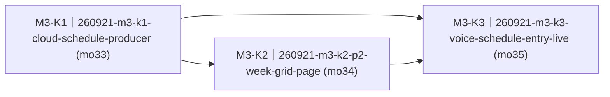

# 阶段三·课表（一周网格 + 家长录入 + 数据接首页）（M3-schedule）· roadmap

> workstream：`m3-schedule` ｜ 设计权威 = `docs/requirements.md` F1 节现文（S-F1.1/S-F1.2/S-F1.3/S-F1.5，v1.19 课表大改口径 + WF-F1-02 周视图线框）+ §6 阶段三 + NFR-READ-1（story 语义权威恒为 requirements 现文）｜ 里程碑注册表行 = `delivery/milestones/milestones.jsonl` M3-schedule（state=planning）｜ 本件 ② 节由 `render-roadmap.mjs` 机械渲染、人工禁改；包集与达成状态权威 = board + `delivery/taskpackages/<changeId>/taskpackage.json`。
> 拆包输入 = 里程碑注册表 M3-schedule nextAction 三块（无 PROPOSAL 输入，`sourceType=delivery-story`）。契约触点（E1 §1.3② 周网格形状 + home upcoming 承载）走 architect-reviewer 四分类 + 人类契约门，随 K1 同 PR（launchPreconditions 第 1 条）。

## ① 效果目标投影

**（投影自 milestones.jsonl M3-schedule nextAction 三块，每块一句人可观察判据 + 指针；不复制 spec 正文。）**

| 目的# | 判据摘要（一行） | 权威指针 |
|---|---|---|
| 1 | 翻到课表页看到一周总览网格：周一~周日 × 上午/下午/晚上，学校课逐节、课外课逐门，今天列高亮、临时安排带 ※、被「接下来」标记的课带星标（小字 ≥14px 可读） | S-F1.2 · 课表页看「一周总览」（AC1–AC4）+ WF-F1-02 + NFR-READ-1 |
| 2 | 随口问「明天有什么课」，答复跟百科问答一样在问答框里给（含备注带物读回），不切课表页；说「帮我显示课表」才切到 P2 | S-F1.3 · 语音问课表（AC1–AC4） |
| 3 | 家长 QQ 录入一条课，课表页/问课表/提醒三处即时用到新条目；直改课表文件走连接/跨天兜底 | S-F1.5 · 家长录入课表（AC1–AC2）+ arch §10 决策 26 |
| 4 | 首页「接下来」从此由课表数据出：联网/零点/录入后即时三触发刷新（决策 26 链路）——阶段一首页在数据侧收尾 | S-F1.1（AC1–AC2 承载面）+ arch §5.2 场景① |

## ② 列车图（依赖 + 批次）

<!-- render-roadmap:begin -->
<!-- 本区块由 .claude/scripts/render-roadmap.mjs 机械渲染（workstream=m3-schedule，渲染时刻 2026-09-21T02:16:48.796Z）。
     人工禁改；渲染源唯一 = board + taskpackage JSON。全量重算、幂等。 -->
<!-- 编号读法：<WS>-<K|N><波次><并行字母?>（如 M1-K2a）——K=承重（被下游依赖或主干终点）、N=游离（无人等待的侧线）；
     波次=依赖深度+1（跨 workstream 外部前置不占波次）；同波次字母=并行占位序、非合并序。编号随依赖重渲染自动重算，确切依赖边以本图为准。 -->

| 编号 | changeId | mergeOrder | 达成状态 | deviation 裁定锚 |
|---|---|---|---|---|
| M3-K1 | 260921-m3-k1-cloud-schedule-producer | 33 | pending（board: queued） | — |
| M3-K2 | 260921-m3-k2-p2-week-grid-page | 34 | pending（board: queued） | — |
| M3-K3 | 260921-m3-k3-voice-schedule-entry-live | 35 | pending（board: queued） | — |
<!-- render-roadmap:end -->

## ③ 每包条目

### 260921-m3-k1-cloud-schedule-producer

- **mergeOrder**：33
- **完成后人能看到什么**：云端有了课表数据的「总调度」——按 B1 课表 MD 三区块算好一周网格（学校课逐节、课外课逐门、临时安排带 ※、当前「接下来」项带星标）和首页「接下来」分组，设备一联网、每天零点、家长刚录完课三个时点推给设备。契约面同步对齐：schedule view 从旧列表形状重定义为周网格（spec v1.19 口径的漂移收口），首页数据承载进了契约。家长 QQ 录入后设备「秒知道」的通道在这一层打通。这是 K2 板端网格页与 K3 语音口径共同的地基。
- **回指**：`S-F1.2 · 课表页看「一周总览」`（补充规则数据口径半）+ `S-F1.5 · 家长录入课表`（AC1 即时链路半）+ `S-F1.1 · 常显首页看「接下来干嘛」」（AC1–AC2 producer 半）+ arch §10 决策 26
- **demo 证据形态**：python -m pytest server/acceptance/ offline 齿（网格计算/upcoming payload/三触发模拟）+ 契约门 evidence 制品；live 三触发复证 deferred 归 K3 设备轮
- **达成状态**：pending

### 260921-m3-k2-p2-week-grid-page

- **mergeOrder**：34
- **完成后人能看到什么**：翻到课表页不再是旧的「今天下午」小列表，而是整周一眼谱：周一到周日七列、上午/下午/晚上三行，学校课一节一节列、课外课一门一门列，今天那列高亮、临时安排带 ※、马上要上的课带星标呼应首页；字再小也不低于 14px 可读线。首页「接下来」也从课表数据出——云端一推，首页日程主体跟着换。课表数据没有或坏了的时候页面友好降级，绝不花屏。
- **回指**：`S-F1.2 · 课表页看「一周总览」`（AC1–AC4）+ `S-F1.1 · 常显首页看「接下来干嘛」`（AC1–AC2 消费接线半）+ NFR-READ-1
- **demo 证据形态**：host runner（WSL linux target）渲染齿 + device build 闸；真机网格目测 + 翻页手感 deferred 归 K3 设备轮
- **达成状态**：pending

### 260921-m3-k3-voice-schedule-entry-live

- **mergeOrder**：35
- **完成后人能看到什么**：孩子问「明天有什么课」「周末有课吗」，答复跟百科问答一样在问答框里给（该带的东西也在答复里念出来），不切页；明确说「帮我显示课表」屏幕才切到 P2 周网格。真机确认轮一次性看全：网格版式/今天列/※/星标、问课表答复、家长 QQ 录一条课后课表页·问课表·提醒三处即时变化、首页接下来三触发刷新——Phase 1 课表闭环的最终目击。
- **回指**：`S-F1.3 · 语音问课表`（AC1–AC4）+ `S-F1.5 · 家长录入课表`（AC1–AC2 live 复证）+ `S-F1.2 · 课表页看「一周总览」`（真机半）+ `S-F1.1 · 常显首页看「接下来干嘛」`（三触发 live）+ NFR-READ-1（网格目测）
- **demo 证据形态**：pytest offline 齿（prompt v6 锚 + 意图路径）+ human 持板真机确认轮（串口 + front/引擎日志三源关联取证，kidpal-serial-monitor / kidpal-live-smoke-debug 纪律）
- **达成状态**：pending

## ④ 非目标与批次归属

- **契约面不在包内自改**：E1 §1.3② 周网格形状重定义 + home upcoming 承载 = 契约变更，走 architect-reviewer 四分类 + 人类契约门（CONTRACT-CHANGE-PACKET 草案在 K1 包目录），契约 diff 随 K1 同 PR 落地；任何包内不直改 `docs/contracts/**`。
- 已砍不拆：「今天/明天」列表视图 + BOOT 长按切换手势 + 语音问课表屏幕联动（§8 已砍清单 v1.19）；「当前课反白高亮」维持砍项。
- 归属说明不拆：S-F1.4 日程提醒 = M1 已交付面（K4/rma8 merged，提醒 producer cron 三档既有能力），§6 阶段三未列。
- 挂账不拆：课表 MD 过期一次性安排「增长治理」（契约 §2.3 留后续）；提醒档位家长侧可调性后置（S-F1.4 补充规则既定）。
- 云端 OpenClaw 本体（ECS 部署）不改架构：K1 录入即时通知走既有交接目录/部署补丁模式（取舍点见 K1 plan.md）；prompt 走版本化演进（v6 新文件、不回改 v5）。
- 跨 workstream 外部前置：无硬前置——M1 键帽条三槽（260915-m1-k2 merged）、M2 撤 P4 三页循环（260917-m2-k2 merged）均已进本地 main；happy-flow-host-capture（open）为问答 capture 基建、与本批课表面不相交。
