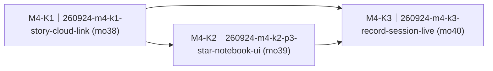

# 阶段四·星星记录本（P3 四态 + F2 改名对账）（M4-star-notebook）· roadmap

> workstream：`m4-star-notebook` ｜ 设计权威 = `docs/requirements.md` F2 节现文（S-F2.1~S-F2.4 + WF-F2-01~05 + F2 intro 改名对账块 v1.33）+ §2.1 记录会话段 + §2.3 手势全矩阵（P3 五行 + 消歧 dev 注记）+ §2.4 P3 行 + §6 阶段四 + NFR-READ-1（story 语义权威恒为 requirements 现文）｜ 里程碑注册表行 = `delivery/milestones/milestones.jsonl` M4-star-notebook（state=planning）｜ 本件 ② 节由 `render-roadmap.mjs` 机械渲染、人工禁改；包集与达成状态权威 = board + `delivery/taskpackages/<changeId>/taskpackage.json`。
> 拆包输入 = 里程碑注册表 M4-star-notebook nextAction 两块（无 PROPOSAL 输入，`sourceType=delivery-story`）。契约触点三处（E1 §1.3③ story_list total 语义拆分与行为句改写 + §1.3④ story_text seq 承载与朗读句清理 + 删除载体新增【拟 §四 `kidpal_story_delete`】）合一走 architect-reviewer 四分类 + 人类契约门，随 K1 同 PR（launchPreconditions LP1）；`kidpal_session_ctx`（§四）契约已 LANDED（CDQ-260914）零改动、只落双端实现。

## ① 效果目标投影

**（投影自 milestones.jsonl M4-star-notebook nextAction 两块，每块一句人可观察判据 + 指针；不复制 spec 正文。）**

| 目的# | 判据摘要（一行） | 权威指针 |
|---|---|---|
| 1 | 翻到 P3 即见星星记录本列表：星星计数 ×N、每条星星图标+标题+日期、选中行带边框默认第一条、超屏分屏「第 x 屏 · 共 y 屏」；BOOT 短按下移/到底翻屏 wrap、双击跳屏、永不离页；页内无标题、提示条含双指令 | S-F2.1（AC1–AC3）+ WF-F2-01 + §2.3 矩阵 P3 列表行 + 设计稿 v5 |
| 2 | BOOT 长按弹整屏删除确认（大字「删掉这篇？」+ 待删条目），KEY 确认删除——条目移除、计数 −1、云端同步（MD 实删 + 流水号不回退）；BOOT 取消 / 10 秒静默取消 | S-F2.1（AC4）+ WF-F2-05 + arch §5.4 故事行 |
| 3 | P3 按 KEY（免触发词）或任意页说「我要讲故事」/「帮我记下来」即开录：引导态「需要我帮你记点什么？」→ 开口进录音态（REC+大时长+声波+整段累积回显、AI 不逐句回复）；「我说完了」/再按 KEY/120 秒自动收尾归档；BOOT 任一手势丢弃不恢复 | S-F2.2（AC1–AC4）+ WF-F2-02 + §2.1 记录会话段 + 契约 §四 |
| 4 | 保存成功那一瞬全屏星星徽章盖章「星星徽章·第 N 颗已入册！」（-8° 微倾定格 0.8 秒 + 小伴跳起），N = 流水号只增不减、重启不回退；回列表计数 +1 | S-F2.4（AC1–AC2）+ WF-F2-03 |
| 5 | 选中一篇 KEY 双击进阅读态：标题+正文分屏（13.5px 起/行高 1.72 可读）、BOOT 翻屏末屏 wrap、KEY 长按退出回列表、KEY 短按不响应——纯阅读无朗读/会话入口 | S-F2.3（AC1–AC2）+ WF-F2-04 + NFR-READ-1 |
| 6 | F2 改名对账四项收口：盖章文案星星徽章 / 页名「我的故事」退役 / 提示补「帮我记下来」/ 选中反白改边框——P3 中文全面真机可见（CJK 字体接线缺陷同批修复） | F2 intro 对账块（v1.33）+ §6 阶段四块② + arch §5.5.4 |

## ② 列车图（依赖 + 批次）

<!-- render-roadmap:begin -->
<!-- 本区块由 .claude/scripts/render-roadmap.mjs 机械渲染（workstream=m4-star-notebook，渲染时刻 2026-09-24T09:18:17.437Z）。
     人工禁改；渲染源唯一 = board + taskpackage JSON。全量重算、幂等。 -->
<!-- 编号读法：<WS>-<K|N><波次><并行字母?>（如 M1-K2a）——K=承重（被下游依赖或主干终点）、N=游离（无人等待的侧线）；
     波次=依赖深度+1（跨 workstream 外部前置不占波次）；同波次字母=并行占位序、非合并序。编号随依赖重渲染自动重算，确切依赖边以本图为准。 -->

| 编号 | changeId | mergeOrder | 达成状态 | deviation 裁定锚 |
|---|---|---|---|---|
| M4-K1 | 260924-m4-k1-story-cloud-link | 38 | pending（board: queued） | — |
| M4-K2 | 260924-m4-k2-p3-star-notebook-ui | 39 | pending（board: queued） | — |
| M4-K3 | 260924-m4-k3-record-session-live | 40 | pending（board: queued） | — |
<!-- render-roadmap:end -->

## ③ 每包条目

### 260924-m4-k1-story-cloud-link

- **mergeOrder**：38
- **完成后人能看到什么**：云端成为星星记录本的数据权威——设备一连上网、每存一篇、每删一篇，P3 列表数据都被推到位（「翻到即见列表」从此有源头）；在 P3 按 KEY 开的会话云端立刻知道是「记录语境」（session_ctx 拦截切累积态、不当问答逐句回）；说「我说完了」或静默 120 秒，云端自动收尾归档、起好标题、带着只增不减的入册流水号 seq 发回设备；删除在云端真删（MD 落盘文件移除、流水号账本不回退）并即时重推列表对账。契约面同批收口：story_list 计数语义拆分、story_text 增 seq、删除载体 kidpal_story_delete 三触点经人类契约门随本包同 PR 落地。这是 K2 板端展示面与 K3 记录会话链路共同的地基。
- **回指**：`S-F2.1 · 看「星星记录本」列表`（AC1 数据源半 + AC4 云端同步半）+ `S-F2.2 · 开录（双入口）`（AC1–AC2 云端累积/收尾半）+ `S-F2.4 · 星星保存成就盖章`（AC2 流水号账本半）+ arch §5.2 场景④ / §5.4
- **demo 证据形态**：python -m pytest server/acceptance/ offline 齿（拦截/推送/删除/收尾/超时/账本模拟）+ 契约门 evidence 制品（十节骨架）；live 全链复证 deferred 归 K3 设备轮
- **达成状态**：pending

### 260924-m4-k2-p3-star-notebook-ui

- **mergeOrder**：39
- **完成后人能看到什么**：P3 整页焕然一新且中文真正可见（story_page CJK 字体接线修复）：列表 = 星星图标+标题+日期、选中带边框、右上 ×N 计数、分屏指示、页名「我的故事」消失、提示条双指令；BOOT 手势全家就位（短按下移/屏底翻屏/双击跳屏/长按删除——300ms 消歧仅列表态、永不离页）；删除确认整屏覆盖弹窗（KEY 删掉/BOOT 算了/10 秒静默取消）确认后条目消失计数 −1；KEY 双击进阅读态（正文分屏排版达标、BOOT 翻屏 wrap、KEY 长按退回列表、短按装死）；盖章演出文案改「星星徽章·第 N 颗已入册！」、N 来自云端 seq、0.8 秒定格真的定格。
- **回指**：`S-F2.1 · 看「星星记录本」列表`（AC1–AC4 板端半）+ `S-F2.3 · 回看记录`（AC1–AC2）+ `S-F2.4 · 星星保存成就盖章`（AC1–AC2 演出半）+ F2 intro 对账块四项 + §2.3 矩阵 P3 三行
- **demo 证据形态**：host runner（WSL linux target）渲染/输入/覆盖层齿 + device build 闸；真机 1bpp 目测 + 手势手感 deferred 归 K3 设备轮
- **达成状态**：pending

### 260924-m4-k3-record-session-live

- **mergeOrder**：40
- **完成后人能看到什么**：记录会话全链活起来——孩子在 P3 按一下 KEY 就见「需要我帮你记点什么？」、开口即录（REC 闪点+大时长+声波跳动、说的话整段累积回显、AI 闭嘴不插话）；说「我说完了」/再按 KEY/静默 120 秒三种方式都能收尾，保存瞬间星星徽章盖章、回列表新星+1；任意页说「我要讲故事」或「帮我记下来」（prompt v7 新指令）同样开录；按 BOOT 丢弃则内容真的消失。真机确认轮一次性看全：双入口、累积回显、收尾三式、盖章 seq、删除云同步、重启流水号不回退——阶段四的最终目击。
- **回指**：`S-F2.2 · 开录（双入口）`（AC1–AC4 板端与跨端半）+ `S-F2.1 · 看「星星记录本」列表`（live 复证）+ `S-F2.3 · 回看记录`（live 复证）+ `S-F2.4 · 星星保存成就盖章`（live 复证）+ arch §5.2 场景④（live 实证态）
- **demo 证据形态**：host 齿（session_ctx 发送缝/手势表/回显消费）+ prompt v7 版本化 offline 断言 + human 持板真机确认轮（串口 + front/引擎日志三源关联取证，kidpal-serial-monitor / kidpal-live-smoke-debug 纪律）
- **达成状态**：pending

## ④ 非目标与批次归属

- **契约面不在包内自改**：三触点（story_list 语义拆分 / story_text seq + 朗读句清理 / 删除载体新增）= 契约变更，走 architect-reviewer 四分类 + 人类契约门（CONTRACT-CHANGE-PACKET 草案在 K1 包目录），契约 diff 随 K1 同 PR 落地；任何包内不直改 `docs/contracts/**`。`kidpal_session_ctx` 契约已 LANDED 零改动——K1/K3 只落实现（front 拦截 / 板端发送）。
- 已砍不拆：阅读态朗读（v1.52）/ 生字跳查字页 + 故事语境会话（2026-09-14 裁）/ 录音「重录」兜底（v1.49 撤）/ S-F2.5 云端润色（§8 不迁入）——K2/K3 相应负锚（TTS_READ 退役、丢弃无恢复）承接「砍项不复活」守卫。
- 归属说明不拆：60s 问答超时 timer 生产者 = M1 遗留（arch to-be ②），M4 不复活、K3 板端零新增计时器（120s 收尾归 front，D4）；P1 V5 版式对账（v1.57）= M1 遗留面；home_upcoming.c / reminder_page.c CJK 字体同族缺陷 = M1 面挂账（drift finding 移交 m1-home-qa 记账，本批只修 story_page.c）。
- 挂账不拆：盖章内圈真实虚线（LVGL9 无 obj 级 dash setter，观感细节归设计殿后）；星星徽章新美术形态若 v5 核对需要 = K2 内资产管线子任务（D7，双分区烧录规则注记在案）；录音真实采音 = 方向 B 会话音频通道既有（manual 聆听 + opus 上行），K3 live 实证非新建链路。
- 云端 OpenClaw 本体（ECS 部署）不改架构：prompt 走版本化演进（v7 新文件、不回改 v6，ADR-001 接线不变式）；删除/推送/拦截全在 front 机械面（零自研业务逻辑红线不变——story.py 归档语义既有、增量为 delete/seq/推送接线）。
- 跨 workstream 外部前置：无硬前置——M1 键路由分层（260915-m1-k1a merged）、键帽条三槽（m1-k2 merged）、语音轮四态（m1-k3 merged）、覆盖层统一（m1-k4/rma8 merged）、M3 CJK 动态文本（m3-k4 merged，仅借鉴字体单源取法不复用 seam）均已进本地 main；audio-bargein-hw（queued 休眠，音频 AEC 面）与本批故事面不相交。
