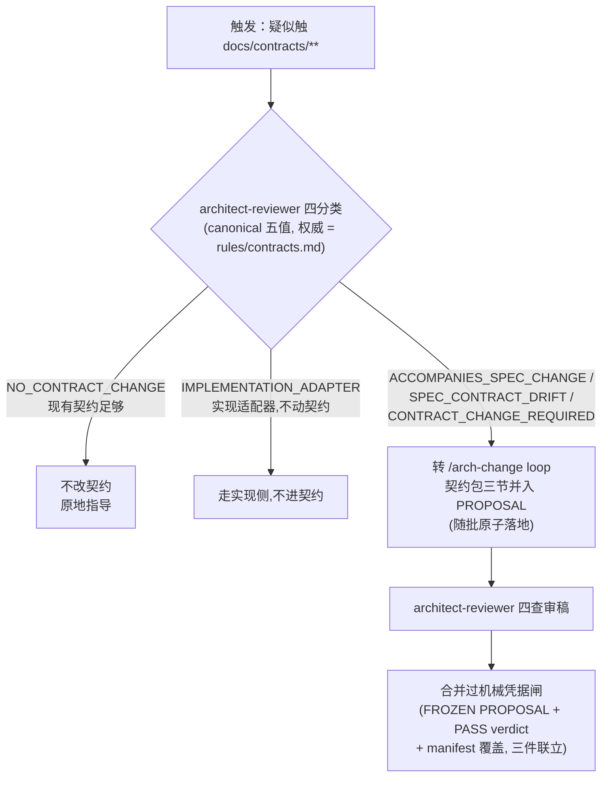
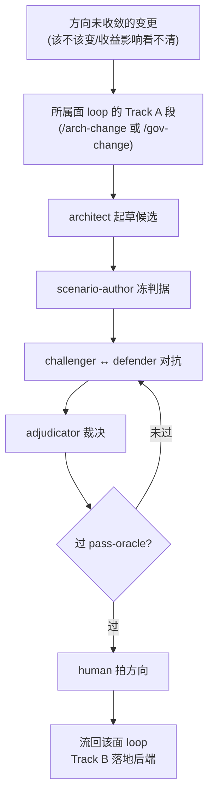
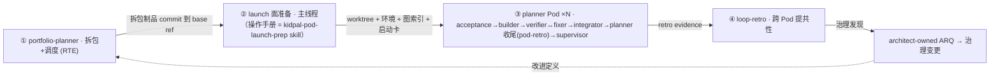
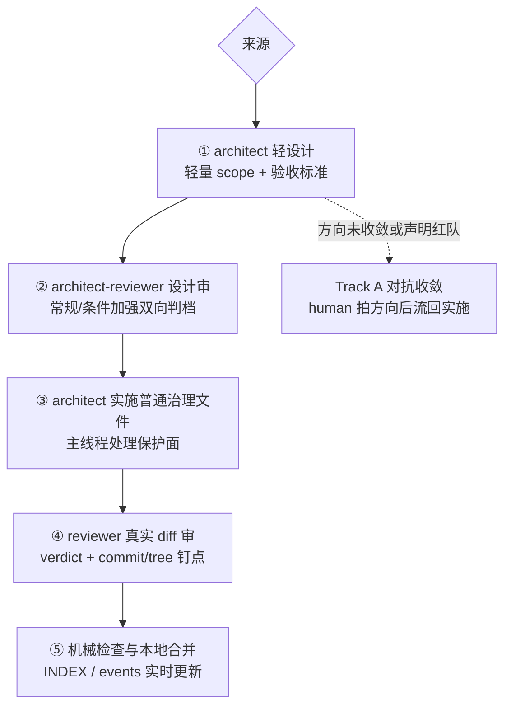
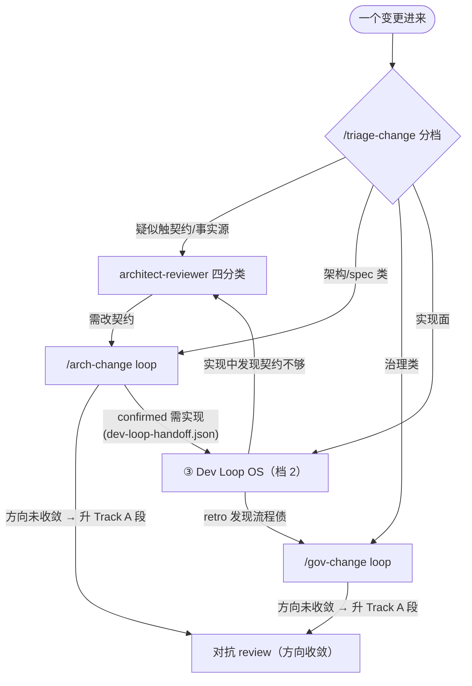

# 开发域治理（DEV-GOVERNANCE）：设计思想与实现

> **迁移注记（2026-08-27 档 1；2026-08-29 档 2/3）**：本文件自 `c:\AI\AInativecompany` 迁移，按 KidPal 实况适配——契约面 = `docs/contracts/**`（单文件 markdown 协议）。档 1（spec 治理：arch-review 对抗链 + 契约门 + Track B）2026-08-27 迁入；档 2（dev-loop 全链 + 测试闸）与档 3（portfolio 编排）2026-08-29 迁入（迁移批 `delivery/review/260829-gov-review-migration-tier23`，栈绑定闸按本仓双实现面重写）。结构参考 = [repo-structure.md](../.claude/rules/repo-structure.md)（本仓结构 SSOT）。流程正文在各 operational 文档；契约 SSOT 永远是 [docs/contracts/**](contracts/)；术语表 = [glossary.md](glossary.md)（已建）。
> 本文件讲清开发域治理**按什么思想设计、如何在本仓实现**。
> **怎么读本文**：想了解 → 上篇 §1–§4；想改东西 → §7 速查；想改治理本身 → §6 → §4 治理变更 → §5。
> **贯穿铁律**：审批在前、改动在后（前置门）；证据入库，聊天结论不结门；冲突按 authority ladder **停下路由**、不静默选择——`docs/contracts/**` > canonical spec > 治理规则 > gate evidence > queues > `delivery/review/` > transcripts。

> 2026-10-29：治理面常规流程改为「轻设计 → reviewer 设计审与双向判档 → architect 直接实施普通治理文件 → reviewer 真实 diff 审 → 机械合并」。Track A 仍只处理方向未收敛；架构+契约面继续 Track B 常驻默认与原 landing 后端。总声明见 `AGENTS.md`，治理面 SSOT = [gov-change.md](../.claude/references/gov-change.md)，对抗机器 SSOT = [arch-review-protocol.md](../.claude/references/arch-review-protocol.md)。

# 上篇 · 思想与实现

## 1. 定位与设计思想

### 1.1 全景定位

本代码库开发 KidPal（小伴）——ESP32-S3 儿童学习伙伴。原仓的两族治理中，KidPal 当前只有 **开发活动的治理**（Part 2：本文件，工程门）；「运行系统的治理」（蓝图 / kernel spec / 6 业务门）未建，将来若产品复杂到需要再立。迁移注记见文首。

**开发域治理（Part 2）= 把业务运行时（Part 1）开发出来的 bootstrap。** 它不是与业务并列的第二套产品。它用当前的 agent / files / hooks / review loop，以同构原则（事件驱动 / 明确 owner / 少数人工门 / 机器验证 / 证据闭环）先行自治目标系统，开发 Part 1。

> 原仓（AInativecompany）的 `.delivery`/`.planning` dogfood 实例不适用本仓、未迁——那是原仓目录名，与本仓 `delivery/**`（2026-09-15 起，260914-gov-review-delivery-restructure）无关。

### 1.2 五条设计思想

**① agent = 敏捷团队里的人。** 每个 agent 不是一次工具调用，而是一个有 JD 的团队成员：职责、边界、write scope 写进它的定义文件（`.claude/agents/**`），协作方式照抄敏捷团队——RTE 分包、SM 带 Pod、开发测试成对、评审会红队对抗、retro 引导改进（§2）。

**② 检查分三族，各归其位。** 机械确定的检查**写进制度**（rule / 脚本 / hook），不占人——人盯确定性事务必然疲劳漏检，制度不会；需要判断的检查交给 **agent 角色**（评审、对抗、裁断）；真正需要负责的拍板留给 **human**（少数人工门，§5）。

**③ 作者 ≠ 判官。** 任何产出物的最终判定者必须独立于作者：spec 由不加载作者身份的 review 会话判，代码由独立 verifier 判，治理由 architect-reviewer 审设计与真实 diff；landing-verifier 只在条件加强时提供第二独立核验。路由与档级也不由作者自裁。

**④ 审批在前、改动在后；证据闭环。** 设计与边界先审后改；结论不落库等于没发生。治理面以轻 PROPOSAL、实时 events.jsonl、真实 commit 和评审钉点留证，dev-loop 证据进 `delivery/taskpackages/**`，未结项进 debt 账本。

**⑤ 治理递归：治理系统自身也被同一套规则治理。** 规则、角色和制度文件的变更同样先独立评审再实施；证明强度按真实风险比例化，不用逐字节搬运证明代替语义审查，human 始终保有新方向、权限与例外裁定权。

> ③④ 是横切原则：③ 落在各流程的独立判定点（adjudicator、verifier、architect-reviewer，以及条件加强时的 landing-verifier）；④ 落在文首铁律、各流程证据栏与工程门判据。

## 2. 团队构图：敏捷角色 → agent

思想①的落地：我们把一个敏捷团队（SAFe 两层）整编制搬进仓里。

| 敏捷团队角色 | 本仓实现 | 干什么 |
|---|---|---|
| RTE（Release Train Engineer） | `portfolio-planner` | 把里程碑 / 倡议拆成排好序、带依赖的 TaskPackage；跨 Pod 调度（WIP limit / merge order / merge token） |
| Scrum Master | `planner` | 单 Pod 循环编排：验收 → 开发 → 测试↔修复 → 集成 → retro → 合并门 |
| AC 撰写（PO 侧） | `acceptance-author` | 把需求写成红基线验收测试，覆盖每条 sourceRef |
| 开发 | `builder` / `fixer` | 实现 / 修红 |
| 测试 / QA | `verifier` | 确定性核验，退出码说话 |
| 集成 / 发布 | `integrator` / merge executor（planner 主线程）| docs-sync + 全量 e2e + closeout；合并走本地可回滚路径（`--no-ff`）|
| 合并把关（release gate） | `supervisor` | 证据可信 + 风险分级放行；高危升级 human |
| 设计评审会 | `scenario-author` / `challenger` / `defender` / `adjudicator` / `review-moderator` | 冻判据 → 红队挑战 → 答辩 → 裁决；主持编排 |
| 首席架构师 | `architect` | 起草 spec / 治理候选；治理面常规批直接实施普通治理文件并自测，保护面归主线程 |
| 架构评审 | `architect-reviewer` | 架构/治理设计四查、契约四分类；治理面双向判档与真实 diff 审，自写评审段 |
| 第二独立核验 | `landing-verifier` | 条件加强时核同一真实 diff / commit；旧批继续核 frozen PROPOSAL 的 landing 保真 |
| retro 引导（跨团队） | `/loop-retro` | 周期性跨 Pod 提共性，治理类进 ARQ |
| 系统级 UI 设计执行 | `uiux-author` | requirement-change 档 2 触 UI 批次按需求修订生成/修订系统级 UI（档 2 流程 4b 生成模式：brief 升版 + 设计 HTML 迭代 + 出图规格单；出图归主线程（`shoot_design.mjs` 管道）；dev-loop 包内不派——消费走 planner 挂图 + brief-inputs 透传） |
| 最终负责人 | human | 立项 ack、例外升级拍板、高影响拍板、治理批准 |

一个 Pod = 一个 git worktree 里的一支敏捷小队：多 Pod 并行开发、**串行合并**（merge token + 进门前 rebase 到当前 main），谁都不并行直落 main（机制见 [pod-coordination.md](../.claude/references/pod-coordination.md)）。

现行编制注：`supervisor` / `verifier` 不设独立 agent 定义（定义已于 2026-07-25 退役），以 **stage 身份**存续，由 planner Bash 直跑机械闸承载（`verify.mjs` round 证据 + `verifier-evidence-check.mjs` + `supervisor-verdict-gate.mjs`，**不派 agent**）。

## 3. 制度构图：机器强制层

思想②的制度族：凡是机械可判的检查，我们**不写成 agent，写成制度**——脚本、hook、配置。制度不疲劳、不看情面、每次都执行。

- **承重 = 机器硬拦，违反即拦**：契约面冻结（review-loop 整毯冻结 `docs/contracts/**`）、docs 顶层白名单、影子目录禁令、直推主干拦截、逐 agent 写边界、收口门、verify-gates 脚本链。
- **灵活 = 判断 + 就近引导**：apps 内部实现、Tier-2 私有模型、文档内容本身。

强制点清单的 SSOT 是 [scope-map.json](../.claude/scope-map.json) 与 [repo-structure.md](../.claude/rules/repo-structure.md)；agent / 制度文件的撰写纪律见 [authoring-agents-skills.md](../.claude/rules/authoring-agents-skills.md)、[prompt-authoring.md](../.claude/rules/prompt-authoring.md)。

## 4. 工作方式：四条流程

团队的日常组织成四条流程，各治理一类对象；真实变更常串起多条（串联示例见 §7）。

### 契约变更 ≈ 架构变更的一种（261015 批：人签门撤销）

- **对象 / 触发**：`docs/contracts/**`（笔顺 JSON / display 响应块 / 课表 MD / shim API）。
- **怎么做**：契约变更 = 架构变更的一种，走 `/arch-change` loop——architect 起草（契约包三节：proposedContractDiff / impact / validationPlan）→ architect-reviewer 四查 → 随批原子落地；纯契约变更同样以该 loop 为入口。**无人类签字门**（261015 批撤销——human 只在立项 ack 与例外升级出场）。
- **防线**：写冻结保留（Bash 重定向写恒拦 + 实现面 agent 与 dev-loop 会话禁写）；合并过机械凭据闸 `pre-merge-escalation-gate.mjs`（三件联立、缺一即 BLOCK）。
- **证据**：owning change folder + 契约决策账 [`docs/debt/contract/`](debt/contract/INDEX.md)（一条目一文件，列义 = loop 凭据不变；原 `docs/CONTRACT-DECISION-QUEUE.md` 261019 批并入并删除）。详见 [contracts.md](../.claude/rules/contracts.md)（五值枚举权威） · [contract-change-evidence.md](../.claude/references/contract-change-evidence.md)。

### 对抗 review ≈ 方向收敛 · 红队（Track A 段）

- **对象 / 触发**：**方向未收敛**的变更——human 立项时判断、reviewer 发现方向级缺口，或声明红队。触及承重机器不自动升级；治理面的常规/条件加强双向判档与方向升级是两件事。
- **怎么做**：所属面 loop 的 Track A 段——architect 起草候选 → scenario-author 冻判据 → challenger ↔ defender 对抗 → adjudicator 裁决 → human 拍方向。治理面随后流回 direct-implementation，架构+契约面流回 Track B 后端；收敛内容不重复全量审查。
- **证据**：`delivery/review/arch-review-<spec>/` + debt 账本 [`docs/debt/`](debt/README.md)（指路 = `docs/debt/README.md`；原 `docs/ARCH-REVIEW-QUEUE.md` 261019 批删除）。机器 SSOT = [arch-review-protocol.md](../.claude/references/arch-review-protocol.md)；入口 = [arch-change.md](../.claude/commands/arch-change.md) · [gov-change.md](../.claude/commands/gov-change.md)。

### Dev Loop OS ≈ sprint 循环

- **对象 / 触发**：自有实现面（固件业务 + 云端 shim，动工前由 human 登记进 scope-map）实现（feature / bugfix / 重构 / 测试修复 / 实现侧 docs-sync）。
- **怎么做**：⓪ 开工前 `/triage-change` 比例化分档（拆包 / Full / Lite / nano / 直接修）→ ① RTE 拆包调度 → ② launch 面准备（主线程，操作手册 = `kidpal-pod-launch-prep` skill）→ ③ planner 带单 Pod：acceptance-author（红基线）→ builder → verifier↔fixer → integrator（docs-sync + 全量 e2e + closeout）→ planner 收尾（pod-retro）→ supervisor 合并门 → planner 前置升级闸放行后本地合并 → ④ `/loop-retro` 周期性跨 Pod 复盘提共性 → 治理类进 ARQ、回流 ① intake，构成**自改进回路**。疑似触契约 → architect-reviewer 兜底。
- **证据**：`delivery/taskpackages/<id>/`（execution ledger）+ `delivery/taskpackages/<id>/`（closeout audit）。详见 [dev-loop-operating-system.md](../.claude/references/dev-loop-operating-system.md) · [dev-loop.md](../.claude/references/dev-loop.md) · [change-triage.md](../.claude/references/change-triage.md)。

### 治理变更 ≈ 流程改进 retrospective

- **对象 / 触发**：G1 / G2 / G3 治理面。owner 与主要起草者 = architect，human 批新方向、权限和例外；常规实施归属按轻量 scope 清单分 architect 与主线程。
- **来源**：human 直接提出，或 pod-retro / `/loop-retro` 形成的 ARQ。既定 ARQ 波次只作一句启动确认，不重复展开已裁修法。
- **怎么做**（步骤编号为外部引用锚点，勿重排；流程 SSOT = [gov-change.md](../.claude/references/gov-change.md)）：
  1. **轻设计**：architect 在 `delivery/review/<changeId>/PROPOSAL.md` 写目标、非目标、关键方案、保护边界、验收标准和轻量 `landing-manifest`，头部标 `gov-flow: direct-implementation`。清单只列路径、实施归属与保护标记，不写逐行改法。
  2. **设计审**：architect-reviewer 四查并自写评审段，判常规流程或具体条件加强，可升可降；GREEN 后主线程标 FROZEN，冻结意图与验收，不冻结未来字节。方向未收敛才转 Track A。
  3. **作者实施**：architect 在非 main 分支修改普通治理文件、自测并提交真实 commit；主线程处理指令根、scope-map、settings、自身与 review-loop agent 定义等保护面。实际非证据 diff 必须 ⊆ 轻量 scope，出界回 reviewer。
  4. **实现审与合并**：reviewer 审真实 diff 和测试判别力，最后 verdict 后出者胜，以 reviewedCommit/reviewedTree 钉最后实现评审。主线程实时写 `events.jsonl`，跑前置升级闸并合并；普通批无强制 landing-verifier、landing-summary/verdict 或事后 retro。第二独立核验、独立 retro 和详细普查按真实风险启用。
- **同步联动**：流程、agent 定义、rules/references、scope-map/hooks/scripts 和本文件投影须同批一致；改 durable policy 记 ADR。
- **详见**：[architect-operating-model.md](../.claude/references/architect-operating-model.md) · [gov-change.md](../.claude/commands/gov-change.md)。

### 四条流程怎么串：一个真实变更的路由全景

# 下篇 · 规则条款

## 5. 工程门体系

> **不变式：工程门 = 本表 6 行。** 任何「新门」裁决必须折进既有行，并在表后「折进注」留一行带出处注记；不得另立枚举。

| 工程门 | 谁把关 | 判据 | 属流程 |
|---|---|---|---|
| 契约机械凭据闸 | 机械闸 `pre-merge-escalation-gate.mjs`（契约 diff 须同批 FROZEN PROPOSAL + PASS landing-verdict + manifest 覆盖，三件联立；261015 批替代人签门） | Tier-1 契约变更 | 面 loop（/arch-change） |
| supervisor 合并门 | 机械闸 `supervisor-verdict-gate.mjs`（planner invoke，不派 supervisor agent）：低/中风险 + 证据完整机器 APPROVE 自动放行（merge 执行由 planner/主线程经前置升级闸放行后本地合并）；高/critical 升级 human；连续 2 轮 BLOCK 未转绿 → 熔断 ESCALATE（计数主体 = 机械闸脚本，FIX-12） | 证据可信 + 风险等级 | Dev Loop OS |
| 对抗 review 人类拍板 | human | deadlock / 高影响 / 跨系统 / 方向未收敛 | 对抗 review（Track A 段） |
| governance approval | human | G1 / G2 / G3 变更 | 治理变更 |
| verifier 闸 | verifier（确定性，靠退出码） | 结构闸 + 功能闸 | Dev Loop OS |
| acceptance 冻结门 | acceptance-author | 红基线覆盖每条 sourceRef，且对真实行为敏感 | Dev Loop OS |

**折进注**（均不新增门，与 6 业务门无关——两族门见 §1.1）：

- **lightweight-architect-review**（已退役，261015 批）= 原「对抗 review 人类拍板」的 depth 子道。架构+契约面仍由轻/主判档承载；治理面由 reviewer 判常规 direct-implementation 或条件加强，可升可降。
- **常驻短链 + Track A 判据升级**：方向清晰的变更不进入对抗机器。治理面走轻设计、作者实施与真实 diff 审；架构+契约面走 Track B。Track A 只处理方向未收敛、根本方案分叉或声明红队，不因触及某个目录自动触发，也不是第 7 工程门。
- **UI design-review BLOCKING** = 经 integrator 写入 Review Packet、由既有 supervisor 合并门消费；severity 阶梯是既有 BLOCKING/SHOULD/NIT 阶梯的解释，不是新轴（见 [code-review-gate.md](../.claude/references/code-review-gate.md)）。
- **`/triage-change`** = bootstrap 期临时信任门（相位化信任模型自原仓移植），非第 7 个工程门、非业务门，不进本清单；其路由裁决的人类确认触点是门内触点（见 [change-triage.md](../.claude/references/change-triage.md)）。
- **closeout 硬化** = 既有 verifier 闸族 `closeout-check` 门内加项：Q5 已裁 warn；教育期四轮观测 pod-retro 自律率 0/3 → 3/3 → 4/4 → 6/6、干净样本 13/13，human 裁 2026-08-25 **维持 warn、零文本改动**（ARQ-111 已结；升 blocking 须修订已冻结 C-07、同 profile full-adversarial + human，触发条件 = 出现非窗口期 pod-retro 缺写实例时重新登记评估）。
- **commit-before-launch launch 前置门** = launch 编排的**结构性前置条件**（制度族机械检查 `git cat-file -e <base-ref>:<path>`，对偶 `taskpackage-required-check.mjs` 起包结构闸），**非第 7 工程门**、非业务门，不进本清单；其 launch 拒止是机械结构校验（判者退出码），非 human judgment 门（governance `ARQ-260729-portfolio-handoff-failclosed` FROZEN v1.0 / F-01·F-10；机制见 [pod-coordination.md §2b](../.claude/references/pod-coordination.md)）。
- **机械 supervisor-verdict 闸** = 「supervisor 合并门」（行 2）的**承载形态变更**，非第 7 工程门（P-5 六门不变式据守）：supervisor agent 2026-07-25 退役后，合并门放行裁决由机械闸 `supervisor-verdict-gate.mjs` 产出（riskTier 从 git diff 重派生 + 证据完整度消费 bearing facts）、Stop 钩子 `supervisor-gate-check.mjs` 第二方验 provenance（`mechanicalSupervisorGate`）+ 从 immutable 输入重算核对（FIX-6）。判据列字面「低/中自动放行」是恢复已成文门力度（J10），非新增。**显式反转前序 human-ruled 裁决**：本闸反转 `gov-review-supervisor-provenance-strength`（FROZEN HUMAN-APPROVED 2026-07-25 冻 `supervisorAgentDispatched===true` required）——supervisor 退役后该钉法不可满足（260729:19-20 planner 诚实拒伪造实证），H7 human 批准反转 2026-07-30（见 [decision-packet](../delivery/review/260730-gov-review-verdict-bearing-dual/decision-packet.md) §6）。

- **前置升级闸（`pre-merge-escalation-gate.mjs`）** = 「supervisor 合并门」（行 2）的 merge-期机械前置（对偶既有「机械 supervisor-verdict 闸」折进注范式）：例外清单命中即 BLOCK 升级人，非第 7 工程门。出处 = 源仓 `delivery/review/260831-gov-review-auto-merge-local-main/PROPOSAL.md`（同步自 commit 6154a6c）。

## 6. 治理的治理（meta）

思想⑤的落地：规则、角色、制度文件本身也是被治理对象。描述任何治理面必须区分四概念——**Authority**（哪个文件是规则事实源）· **Owner**（谁负责提出 / 维护）· **Writer**（哪个 agent 可实际改）· **Approver**（谁批准）。architect 是开发治理 owner 与主要起草者，普通文件可在已审 scope 内直接实施，保护面由主线程写；architect 不自批，也不替代契约门或合并门。

| 治理面 | 文件 / 目录（= 该面 authority） | Owner / Writer | Approver |
|---|---|---|---|
| **入口与指令根（G1）** | `AGENTS.md`、`CLAUDE.md`、`docs/DEV-GOVERNANCE.md` | architect / 主线程（保护面落地） | **human** |
| **角色与流程定义（G2）** | `.claude/{agents,commands,references,rules,skills}/**` | architect / 按 scope 分工（自身与 review-loop 定义归主线程） | **human** |
| **强制执行层（G3）** | `.claude/scope-map.json`、`.claude/*.settings.json`、`.claude/verify-gates.json`、`.claude/{hooks,scripts}/**` | architect / 按 scope 分工（权限与设置归主线程） | **human** |
| **证据与队列（G4）** | `delivery/review/**`、`delivery/taskpackages/**`、`docs/debt/**`（四域账本，含 contract 契约决策账） | 按流程分工 | 按流程分工 |

**硬条款**：

1. **AGENTS.md ≡ CLAUDE.md**：同类常驻指令根，同 owner / writer / approver，不得一个可写一个不可写。
2. **agent 定义只归 architect 起草**：`.claude/agents/**` 的职责、边界、工具与 write scope 变更由 architect 起草并须经 human 审核。普通非 review-loop 定义可由 architect 在已审 scope 内实施；自身与 review-loop 定义由主线程处理。builder / fixer / planner / reviewer 不得自改或代改。
3. **自改递归**：修改自身定义、权限边界、工具、write scope，或影响自身权限的强制执行层文件，必须升级为 human-approved governance change，不得自批，也不得借他人代写绕过；物理写权以 scope-map 为准。
4. **第五阀（review-loop 自指）**：改 review-loop agent 自身定义时，其任何 re-review 必须在新改动 canonical 生效前跑，或由不加载被改 description 的独立会话 / harness 跑。本阀不因常规流程简化而取消。

**landing 通道（按面分开）**：`/gov-change` 常规 = architect 直接实施 ordinary 普通治理文件并提交，主线程处理指令根、scope-map、settings、自身与 review-loop agent 定义等保护面；reviewer 审真实 diff，landing-verifier 只在核心合并/权限自改、高影响难回滚、争议或真实语义风险时第二独立核验。轻量 manifest 只做实际非证据 diff ⊆ 预计 scope，不恢复逐字节保真。`/arch-change` 继续既有 packet-bound / author-implementation 与 verifier 义务。human 把关新方向、权限和例外；本地合并经机械闸，远程发布边界不变。

**三类制品**（不替代 authority）：

| 类别 | 例子 | 规则 |
|---|---|---|
| 耐久 canonical | contracts、kernel/system specs、G1–G3 规则 | 定义“现在是什么”；只能按对应门修改 |
| 执行状态 | `delivery/workstreams/<workstream>`、`delivery/taskpackages/<id>/`、`delivery/milestones/`、Pod board/token | 服务正在进行的拆包与调度；不是政策或审批替身 |
| 审计证据与队列 | `delivery/review/**`、`delivery/taskpackages/**`、frozen proposal / charter / findings / decision packet / verdict；ARQ 管 spec/governance soundness 未结，CDQ 管 Tier-1 契约 shape/接线 | 记录“为何、谁、按何判据”；冻结后不得静默重写 |

**收口义务 → 承载写点映射（261027-gov-review-p75-closeout-shoot-cluster · 承载 ARQ-261014）**

**这张表回答「收口期该落的制品由谁写」。** 与 §7「入口速查」分工：§7 管「从哪个入口改、谁批准」，本表管「收口落盘时写点在哪」；同一义务两表都出现时，批准看 §7、写点看本表，两表不得互相扩写。边界：本表只收**收口期落盘、且 §7 未给具体写点**的义务——ADR 条目、`delivery/review/**` 记账等已由 §7 载明的义务不并入；§7 末行的「ARQ / CDQ｜按来源流程记账」只指入口与账本归属，具体写点由本表第一行补全。

| 收口义务 | 承载写点 | 依据 / 边界 |
|---|---|---|
| 账本条目登记（`docs/debt/<域>/`，原 CDQ 行） | **主线程**（登记动作）；包内收口可落 = integrator（`docs/debt/**` 写槽）、review 收口可落 = adjudicator（同写槽） | 261019 批 CDQ 已并入 `docs/debt/contract/`，写权真空闭合；planner / architect 无该写槽 |
| 设计稿母版内容级同步（`docs/ui/kidpal-ui-design-vN.html`） | **主线程**（Pod 外的真主线程会话）；需求面 loop 档 2 在场时由 uiux-author 增量修订 | Pod cast 缺省不含 uiux-author，且 Pod 主会话受持会话 agent 的 per-agent 写权约束——「主线程通道代落」在 Pod 内不成立；母版升版与声明面纪律见 `docs/ui/UI-DESIGN-VERSIONS.md` |
| 出图（400×300 PNG 画布帧） | **主线程** | 管道 = `node tools/asset-pipeline/shoot_design.mjs <母版绝对路径> <输出目录>`，不经 Open Design；用法见 `.claude/skills/opendesign-connect/SKILL.md`「出图管道」节 |
| spine 回填（`delivery/intake/<changeId>.md` 的 `anchors` / `status`） | **主线程** | 无任何 agent 的 scope-map allow 覆盖 `delivery/intake/**` |
| spec 挂法句（`docs/requirements.md` / `docs/architecture.md` 的同步句） | **architect**（各自面 loop 内）；dev 包检出 spec 漂移 → 交 architect、零自改 | `ARQ-260929-docs-sync-spec-handoff` 已结裁定：integrator 对两份 spec 文件零写权 |
| 经验记录（`docs/notes/**`） | **主线程**（Pod 外） | 无 agent allow 覆盖 `docs/notes/**`；Pod 主会话 = planner agent，`deny docs/**` |
| taskpackage 元数据回填 | **planner** | acceptance-author 写槽不含 taskpackage；派发书不要求其回写，交付内容由 planner 预指派代落（planner「派发书三条硬约定」②） |

**为什么成文**：这类义务原先每包收口期现场即兴找写点，找不齐就升级 human 裁「主线程直落」，同型复发四包（2026-10-14 loop-retro T4）、三包（2026-10-25 T10）。写点在这里一次钉死；planner 的 finalize 核对（`.claude/agents/planner.md` Step 8c）按本表执行。**本表是文面映射，不构成任何 scope-map 换授**——写权矩阵以 `.claude/scope-map.json` 为准，二者不一致时以 scope-map 为真、并按治理变更修本表。

## 7. 入口速查

本表是 §1–§6 的索引，不是规则本身。**写点 / 写权类问题不在本表**——收口期该由谁落盘见 §6「收口义务 → 承载写点映射」，本表只答「从哪个入口改、谁批准」，两表不得互相扩写。

| 我想改... | 入口 | 批准 |
|---|---|---|
| `docs/contracts/**` | `/arch-change` loop（契约包三节并入 PROPOSAL；architect-reviewer 四分类过滤保留） | 机械凭据闸（无人签门；human 出场 = 立项 ack / 例外升级） |
| 系统 spec（KidPal：`docs/requirements.md` + `docs/architecture.md`） | `/arch-change` loop（方向未收敛 → Track A 段对抗收敛） | architect-reviewer 审稿 + human 立项 ack / Track A 拍方向 |
| L0 蓝图 | `/arch-change` Track A 段（= 跨系统结构性变更）；备改法交人类，不自动落地 | human |
| 系统级 UI 蓝图 / UIUX·OpenDesign 治理 | `/gov-change` 携带 UIUX 轴集（非新工程门；系统级 brief 起草候选） | human（跨系统 / 主流程 / IA / 品牌）；局部低风险可 loop 落 |
| 自有实现面（固件 / shim） | `/triage-change` 比例化五档 → reviewed plan → Dev Loop OS | supervisor 合并门 |
| agent 定义 | `/gov-change`；architect 起草，普通定义可由作者实施，自身与 review-loop 定义由主线程处理；被改 agent 不得自批 | **human** |
| command / reference / rule / skill | `/gov-change` 轻设计与真实 diff 审；常规或条件加强按行为风险判定 | human |
| scope-map / settings / verify-gates / hook / script | `/gov-change`；普通脚本可由 architect 实施，权限与设置保护面由主线程处理，核心合并逻辑按条件第二核验 | human |
| README / AGENTS / CLAUDE / 治理文档 / 蓝图 | `/gov-change`（L0 蓝图见上行 Track A 段语境） | human |
| `docs/decisions/ADR.md`（架构决策记录） | integrator 收口落新增条目 / 主线程治理批落条目；条目格式与 append-only 约定见该文件头（T7，260907 批立；2026-10-19 human 裁迁 `docs/decisions/`，261019 批） | 对应流程 |
| `delivery/review/**`、`delivery/taskpackages/**`、ARQ、CDQ | 按来源流程记账 | 对应流程 |

> **入口总览**：每面一个 loop 入口——需求 `/requirement-change` · 架构+契约 `/arch-change` · 治理 `/gov-change` · 实现 `/triage-change` → `/build-feature`；跨面由统一 intake 建 spine。治理面默认轻设计、作者实施与真实 diff 审；架构+契约面继续 Track B。只有方向未收敛、根本方案分叉或声明红队才进入所属面的 Track A 段。
> 一个真实变更常**串起多条**：spec 触契约 → 契约包随批原子落（机械凭据闸放行）；confirmed 需实现 → 产 `dev-loop-handoff.json` 进 Dev Loop OS；实现中发现契约不够 → `architect-reviewer` 四分类后转 `/arch-change`；retro 发现流程债 → `/gov-change`。

## 8. 已知缺口

尚未成文的开发过程流程先登记，后续按**治理变更**补；对应流程成文 landing 后从本节移除，不滞留已结项。

- **repair-intent 自动化桥（Phase 9）**：入口已定为 portfolio-planner intake；把 K6 `DefectDetected` 自动变成 repair-intent 制品并触发 launch 的 automation bridge 仍是未来占位。
- **新系统创建的 `.claude` 扩充**：新增 K/S 系统时 agent 克隆体、scope-map、hook 的扩充流程。
- **`.claude/**` 一致性机械门**：agent 定义 ↔ scope-map ↔ command 引用的一致性检查。**已分批部分落地**（批次 1 / 批次 2 / 腿 6 launch 可达性 `--check-launch`）；剩余子项与消费方链原见 ARQ-077（原单文件队列 ID，未迁入现行 debt 账本，队列文件 261019 批删除——以本节记述为准）。

## 验收测试纪律

> 成文：260906-gov-review-arq-governance-batch（FROZEN v1.0，Track B）；承载 ARQ-260901-g3-server-live-acceptance / ARQ-260906-live-acceptance-real-path / ARQ-260902-frozen-acceptance-never-run。unit-run-check.mjs / acceptance-run-check.mjs 行内注释与本节同名互指。

### 1. server 验收 host/live 两态

server 面验收分两态：

- **host-fast**：可在本机/CI 快速执行的 pytest。unit/acceptance 两闸执行器在闸内真跑。
- **live on-target**：需 SSH 上 ECS / 真机 / 外网凭据的验收，以 `@pytest.mark.live` 标记。两闸执行器只走结构闸、**不 auto-run**（merge/CI 环境无 SSH/凭据，auto-run 必假红；对偶固件 on-target 只结构闸）——live 验收由 acceptance 相位人工/台架触发并落 verifier-evidence。

**pytest-not-installed 语义**：host-fast 路径下 pytest 未安装 = fail-open 跳过并 warn（对偶 firmware idf.py 缺失），**不是**绿灯依据——闸担保「不静默跳过」，不担保「实机已过」。

**两态在条目/类级判**（260909-gov-review-gate-truthfulness T1c/T4）：闸内以 `pytest -m "not live"` 执行，禁按文件级标记整份排除（实测病灶：`server/acceptance/` 9/9 混合件曾被文件级判据整份放行）；一文件内混排两态合法，全为 live 面时闸须显式报 `allLiveDeselected` 而非静默 skip。闸「没跑成」（degraded / executor-skipped / allLiveDeselected）由 verify.mjs 上收为 round evidence 的机器可判字段 `notExecuted`；**`notExecuted` 非零时 verifier 报告必须逐条点名**（该字段不当第二道门、不改 ok 判定——可见性义务，机械消费另批）。

### 2. probe ≠ exercise（live 验收必须真跑一遍真实链路）

跨进程包的 live 验收必须真 exercise 一次真实端到端路径（最小 tracer-bullet 即可），**只探测可达不算 live 验收**。验收起草（acceptance-author）与核验（verifier）两级遵守。教训实证：G 包 live 验收当年只探端口可达，六个真实链路缺陷（websockets 版本不兼容、缺 device-id 头透传、TTS type 拼写、OpenClaw base_url 缺 `/v1`、容器 loopback 不可达、Intent 拒绝）全递延到 WS 包真机冒烟才连环爆（ARQ-260906-live-acceptance-real-path）。

### 3. 冻结即冒烟（线束通道 error 为零）

冻结验收落盘时，acceptance-author 当场执行一次线束冒烟：live 面真连一次 SSH 可达性、线束助手（连接/读写/payload）真调一次、pytest 收集零错误。判据 = **执行通道 error 为零**（error ≠ failure：收集错/夹具崩/线束异常 = 线束缺陷，当场修）；断言 failure 是冻结相位的设计态（实现未建、红基线），不阻塞冻结。为什么只冒烟线束、不要求断言转绿：历史病灶（`_ssh` 解包、payload 撞命令行上限）全部落在线束层、**不需要被测实现存在**就会炸（TP-A 与 smoke-e2e 两度实证，ARQ-260902-frozen-acceptance-never-run）。

### 4. C 类冻结验收实编（编译通道 error 为零）

C 类（固件/结构面）冻结验收文件落盘时，acceptance-author 当场实编一次该验收文件本身（C 编译器过一遍），判据 = **编译通道 error 为零**。红基线对结构/基建类包明示「验收文件本身可编译」：§3 的线束冒烟清单（SSH/线束助手/pytest 收集）不含编译通道，C 验收的语法缺陷（宏参数形态、复合字面量分组等）只有实编才暴露——260829-host-test-infra 实证：`host_infra_smoke.acceptance.c` 宏参编译错误到 builder 首实编才爆、退回 acceptance-author 返工（ARQ-260907-frozen-acceptance-compile-baseline）。§3 管执行通道、§4 管编译通道，两者并列不互替。

### 5. 退役保留目录名（`archive`）

**`archive` = 两面（firmware / server）的退役保留目录名；现役测试禁落该名。**

- **语义**：任意深度上名为 `archive` 的目录 = 退役保留面。归档件按定义**非现役面**——**「移位即退役」**：一个测试文件一旦移入 `archive/`，即不再属现役验收 / 单测集合。
- **代码承载点（两处 `SKIP_DIRS` + 一处配置，三处须同口径）**：`.claude/scripts/unit-run-check.mjs` 的 `SKIP_DIRS`、`.claude/scripts/acceptance-run-check.mjs` 的 `SKIP_DIRS`、`server/pytest.ini` 的 `norecursedirs`。任一处缺 `archive`，该闸就会把退役件当现役枚举——表现为该相位系统性常红、或清点报数虚高。
- **为什么成文**：该约定原只活在两处代码注释里、**包作者不可见**——现役测试误落该名会被**静默不跑**（不报错、不收集），是最难发现的形态。实证：260916-unit-gate-archive-recursion（unit 闸纳入 archive → final 相位系统性常红 + 裸 pytest 基线 121F 假红）；260918-gov-review-closeout-chain-friction T1（acceptance 闸固件面枚举 22 件中 **13 件是归档退役件**，跳 archive 后为 9 件现役）。

### 6. tighten-only 修订窗口（冻结件的纯加严修订）

冻结验收件原则上不许改（防实现方「改测试让它通过」）。**唯一例外 = 本节窗口**：acceptance-author 可在**不新建文件、不改动既有断言语义**的前提下**纯 additive 补齿**。**这是「给冻结件开后门」的授权边界，故配防滥用五件**：

1. **纯 additive 机器可判**：`git diff -U0` 对冻结件的**删除行数 = 0**（本条是机器闸——非 0 即违规）。
2. **新齿必须重跑当初暴露 vacuity 的原变异**并证明转红（**不许另造易过变异自证**）；**`sha256` 还原核销**——记入该冻结件 `REVISION LOG` **同一条**，格式 `<前 sha256> → <后 sha256>`。（**如实声明**：本仓现**无已执行的 `sha256` 核销先例**——`7ab2d47` 仅留行数计数、未记 hash；本节落地后为**首例**。）
3. **三件记录**：① 冻结件 `REVISION LOG` append 带 `Reason`；② taskpackage 的 `mutationEvidence` 该条 `sensitive: false → true`；③ 红基线摘要补一段。
4. **范围帽**：同 Pod、同既有冻结件、**不新建文件**。
5. **意图锚定**：新齿须钉**既有** `acceptanceRef` / `decisionCoverage` 的**原意图**；若需新 acceptance id、或须改行为定义 ⇒ 属 **re-spec**、**升 human**。

**超窗即改验收**：不满足以上五件任一条的修订 = **非** tighten-only，须走正常返工 / 改验收通道（可能触 human）。`mutation-check` 会跑出 `insensitive` 但**不判谁有权补 oracle**——本节的职责正是补上「**谁、在什么边界内**」这个答案。

## 起包格式期望前置（planner / portfolio-planner / acceptance-author / builder 四方）

> 成文：260907-gov-review-arq-governance-batch-2（T6）；承载 ARQ-260907-taskpackage-format-expectations-frontload。格式期望只活在闸的判定代码里、起草侧零成文 = 靠闸红反推再回派（跨 4 包 5 子项实证）。六条前置清单：

1. **mutationEvidence 骨架**：Draft TaskPackage 必须带 mutationEvidence 字段骨架（空骨架也行，字段必须在场）——portfolio 起草不带骨架，mutation-check 闸红一轮再回派补（260903-gateway-directionB / 260829-session-logic 两度实证）。
2. **验收断言格式期望**：acceptance 面写机器可识别断言形态（acceptance-coverage-check 可认的断言风格）+ coverage 标记随测试名——markdown prose 断言会被判「无可识别断言」回派补写（260831-ui-art-assets 实证，回派补 31 条）。
3. **验收 ID 禁括号后缀**：acceptanceRef 形态为 `Sx-Ay` 等 kebab 短横形态，禁 `(B#)` 类括号后缀——括号破坏闸正则 `\b` 词边界匹配，标记被迫写尾随下划线丑形态（同包卡点 3）。
4. **降级声明前置**：资产/规划类包对 mutation / docs-sync 的降级声明（不适用 + 理由）在 Draft TaskPackage 阶段写字段，不等到 verifier 红才补（同包卡点 4）。
5. **新约定包同步闸判据自查**：建新约定（新目录、新测试通路等）的包，dispatch 时同步查相关机械闸的判定口径——闸判据滞后到全量终审才发现 = vacuous-green 风险（260829-host-test-infra 实证）。
6. **输入面期望前置（input-brief + 超读申报 + crossEnd）**：派发的输入面必须是**起包期派生的封闭清单**，不是子 agent 每次自扫。三件一体：① planner 在 Step 7 派发前用 `.claude/scripts/brief-inputs.mjs` **一次产单份** input-brief（`input-brief.md`，acceptance-author + builder 共用——261015-gov-review-lite-fast-path T4 双份并单份，从 TaskPackage refs + `crossEnd` 派生：契约/spec 锚点节定位 + 跨端对端面 + 同 subsystem 先例封顶 3 个；bug 类包 story 节为指针形态、头部改动指令源行指向 plan.md），派发 prompt 只引用 brief 文件路径与纪律一句、**不转抄清单正文**（防双源漂移）；② 子 agent 清单外阅读**允许且是常态**，但交付报告必须列「清单外阅读 + 原因」段——**超读是常态动作，不申报才是问题**（把申报做成硬门槛只会逼出隐瞒、让仪表盘失去意义）；③ `crossEnd` 申报字段 Draft 必在（空骨架也行，同第 1 条）+ finalize 时 `counterparts` 非空（每条含 path+symbol，本批限自有实现面）**或** `exempt` 写明理由（≥12 字符，同本闸 `landsIn=dropped` 判据）二选一，双缺 = 闸红点名（与第 1/4 条同型）。跨端性是设计判断不是可推导属性——subsystem 单面标签的包可以业务实跨端，故走申报 + 留痕而非硬谓词。成文：260908-gov-review-input-surface-frontload；实证：`260829-story-p3/pod-retro.md:11`「把 spec/契约/先例读了个遍」stall 案 + `260907-g-relay-fix` 自创 `display_relay` 帧离线全绿、真机被固件 `Unknown message type` 拒案（其 pod-retro「下次改进 1」即本条第 ②③ 件的前身）。

## friction 事件最小 schema（dev-loop 记账）

> 成文：260907-gov-review-arq-governance-batch-2（T4）；承载 ARQ-260907-friction-event-payload-schema。聚合告警面 = `pod-events-aggregate.mjs` `friction.malformedFrictions` 列（残缺事件显式点名，不再静默归 unknown）。

pod-events 的 friction 事件 payload 最小 schema：**`frictionType` + `summary` 必填**（frictionType 用既有关键词形态，summary 一句话讲清现象）；附加细节允许扩展键（非标键会被聚合归 unknown——用扩展键时仍须带齐两个必填件）。**空 payload `{}` = 落账缺陷**：内容机器侧不可恢复即实际证据丢失（260829-voice-roundtrip 两条空 payload 实证，其一内容只能从 commit message 追回、另一条彻底丢失）。落账时点 = 摩擦发生的当次交互内（planner / 主线程随手记），不攒到收口补记。
